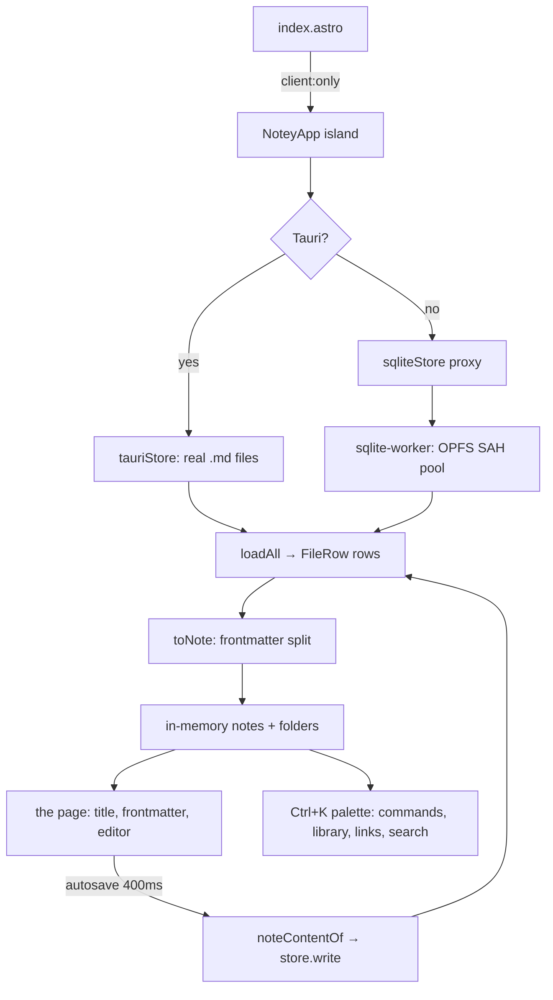

# Architecture

notey is a static Astro site with one Svelte island per page. The island owns
a **vault** — a virtual filesystem of Markdown notes — and renders one page of
paper. Everything that is not writing happens in a command palette. The
editor stack (three faces, footnotes, diagrams, drawings, maths) is ported
from the sibling `useful` repo's notebook tool; the vault, the page and the
palette are new.

_Describes the code as of v0.1.0 (unreleased; schema v1) — verify against source when in doubt._

## File map

| Path | Role |
| --- | --- |
| [src/pages/index.astro](../../src/pages/index.astro) | Mounts `NoteyApp` with `client:only="svelte"` |
| [src/pages/settings.astro](../../src/pages/settings.astro) | Mounts `SettingsApp` |
| [src/layouts/Layout.astro](../../src/layouts/Layout.astro) | Letterhead, theme pin, manifest, service-worker registration, test hook |
| [src/components/NoteyApp.svelte](../../src/components/NoteyApp.svelte) | The app: vault, the page, autosave, exports, bulk actions |
| [src/components/CommandPalette.svelte](../../src/components/CommandPalette.svelte) | Ctrl+K — every command and every navigation |
| [src/components/notebook/](../../src/components/notebook/) | The ported editor: `MarkdownEditor`, `MarkdownPreview`, three dialogs |
| [src/lib/vault/](../../src/lib/vault/) | The storage seam and its three backends |
| [src/lib/notebook/](../../src/lib/notebook/) | Pure note logic ported from useful: wiki links, footnotes, mermaid, export, bulk |
| [src/lib/markdown.ts](../../src/lib/markdown.ts) | The one sanctioned Markdown pipeline (marked + DOMPurify + Prism) |
| [src/lib/prefs.ts](../../src/lib/prefs.ts) | Per-device preferences and the unfiled scratch page |
| [public/sw.js](../../public/sw.js) | The service worker |
| [src-tauri/](../../src-tauri/) | The desktop shell |

## The stack

Astro 7 (static output, no adapter) · Svelte 5 with runes · TypeScript strict ·
sqlite-wasm in a worker for the browser vault · Tauri 2 for the desktop
build · Milkdown Crepe + CodeMirror 6 for the editor · marked + DOMPurify +
Prism for rendering · KaTeX, mermaid and Excalidraw, all lazily.

## Runtime



The whole vault is read once into memory at boot and re-read after every
write (`refreshFromRows`). That is deliberate: wiki links, backlinks and
search all need every note's body, so there is no cheaper shape, and a
personal vault is small enough that a full re-read is imperceptible.

## Directory map

```
src/
  components/
    NoteyApp.svelte          the app shell: the page and everything it owns
    CommandPalette.svelte    Ctrl+K: commands, library views, bulk actions
    SettingsApp.svelte       the settings page
    Icon.svelte              inline Lucide glyphs
    notebook/                ported editor + dialogs
  layouts/Layout.astro
  lib/
    vault/                   types, model (paths), frontmatter, stores, search
    notebook/                pure note logic (wiki, footnotes, mermaid, export…)
    markdown.ts prefs.ts paths.ts zip.ts fuzzy.ts exportFile.ts icons.ts
  pages/                     index.astro, settings.astro
  styles/                    theme.css (tokens), global.css (base + utilities)
```

## Invariants

Each of these is load-bearing; the Playwright spec named in
[testing.md](testing.md) checks most of them.

- **The markdown string is the single source of truth.** The editor is a view
  over it. Autosave writes 400 ms after the last change and is flushed on
  pagehide, visibility-hidden, note switch, unmount, and before every export
  or bulk action.
- **Page load writes nothing.** The app opens on the unfiled page; an
  unresolved `?note=` deep link offers a Create button rather than creating.
- **A note's title is its filename.** Renaming moves the file; the old title
  is pushed into frontmatter `aliases`, so `[[Old title]]` keeps resolving.
- **Backlinks are computed, never stored.** They cannot go stale.
- **Deleting a notebook never deletes notes.** Its notes and subfolders move
  up one level, assets included.
- **The editor is keyed on the open document, not on the path.** A rename
  changes the path; keying on it would rebuild the editor mid-typing.
- **Design tokens keep useful's names.** The ported editor consumes
  `--surface-color`, `--color-stamp`, `--space-*`; only the values are notey's.

## Adding a feature

1. Pure logic goes in `src/lib/` with a co-located `*.test.ts`.
2. If it touches storage, it goes through the `VaultStore` seam — never
   directly to sqlite or the filesystem — so both builds get it.
3. If it is a command, it goes in the palette's `commands` list rather than
   growing chrome on the page.
4. New pages join `SHELL` in `public/sw.js` and bump `CACHE_NAME`.
5. Give it a page in `docs/dev/` and `docs/user/`, and a Playwright case.

## Known limits and decisions

- **The whole vault lives in memory.** Fine for a personal vault; a vault of
  tens of thousands of notes would want an index. Recorded in
  [far-fetched.md](plans/far-fetched.md) along with why FTS5 was not used.
- **One tab at a time.** The OPFS SAH pool takes exclusive handles, so a
  second tab is refused with a clear message rather than silently opening a
  different database.
- **No sync.** The vault is one browser or one disk; the export is the
  escape hatch.
