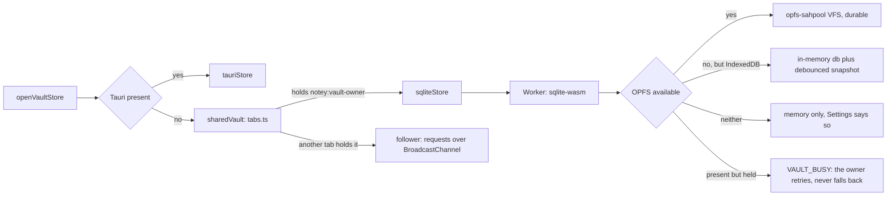
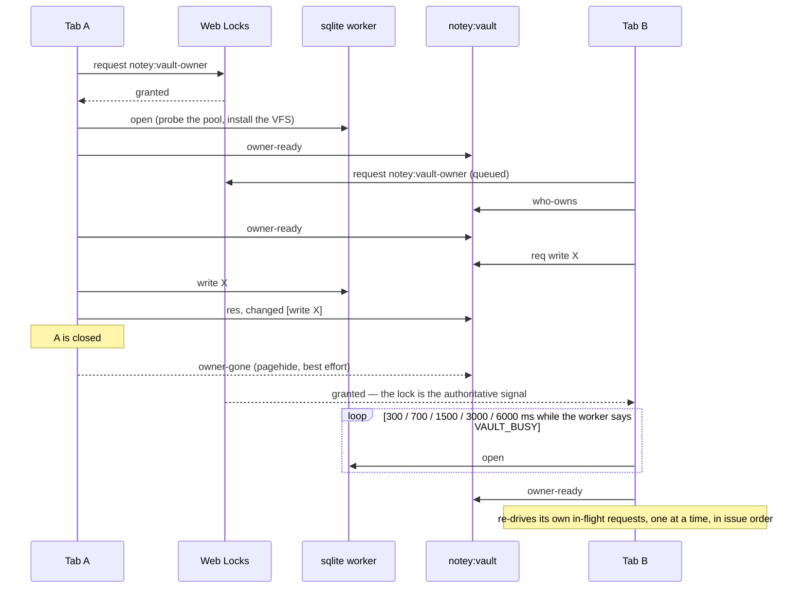
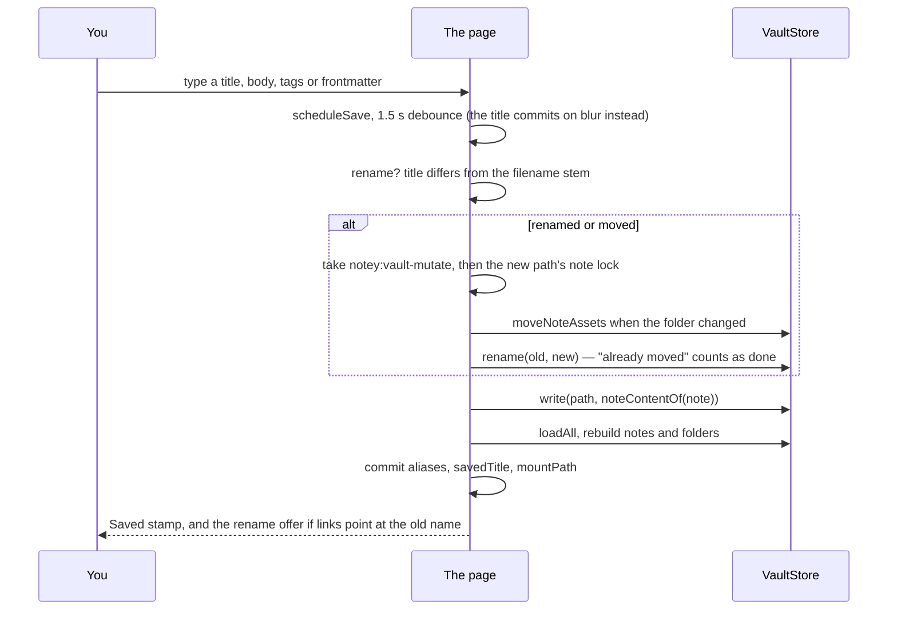

# The vault

A vault is a virtual filesystem of Markdown notes. Paths are the identity:
`Work/Ideas/Big plan.md` is both where the note lives and what everything
else calls it. A top-level folder is a **notebook**, a root-level note is in
the **Pile**, and a note's images live beside it in `.assets/`. One interface
— `VaultStore` — has three implementations, so the browser build (sqlite-wasm)
and the desktop build (real files) share every line above it.

_Describes the code as of v0.1.0 (unreleased; schema v1) — verify against source when in doubt._

## File map

| Path | Role |
| --- | --- |
| [src/lib/vault/types.ts](../../src/lib/vault/types.ts) | `FileRow`, `Note`, `FolderEntry`, the `VaultStore` interface |
| [src/lib/vault/model.ts](../../src/lib/vault/model.ts) | Path algebra and the `FileRow` to `Note` conversion |
| [src/lib/vault/frontmatter.ts](../../src/lib/vault/frontmatter.ts) | YAML frontmatter: tolerant in, lossless out |
| [src/lib/vault/fmFields.ts](../../src/lib/vault/fmFields.ts) | The three field shapes the header edits: text, list, YAML |
| [src/lib/vault/transfer.ts](../../src/lib/vault/transfer.ts) | Notes in and out: the zip, and a dropped file — see [export.md](export.md) |
| [src/lib/vault/desktop.ts](../../src/lib/vault/desktop.ts) | Which folder the desktop vault is in — see [tauri.md](tauri.md) |
| [src/lib/vault/desktopPaths.ts](../../src/lib/vault/desktopPaths.ts) | The path arithmetic behind it |
| [src/lib/vault/sqlite-worker.ts](../../src/lib/vault/sqlite-worker.ts) | All SQL, the schema, the persistence tiers |
| [src/lib/vault/sqliteStore.ts](../../src/lib/vault/sqliteStore.ts) | Main-thread RPC proxy to that worker |
| [src/lib/vault/tauriStore.ts](../../src/lib/vault/tauriStore.ts) | Real `.md` files in the folder the desktop is pointed at |
| [src/lib/vault/memoryStore.ts](../../src/lib/vault/memoryStore.ts) | In-memory store — and the contract's spec |
| [src/lib/vault/store.ts](../../src/lib/vault/store.ts) | The backend picker, one store per page; `onVaultChange` |
| [src/lib/vault/tabs.ts](../../src/lib/vault/tabs.ts) | Many tabs, one database: the owner/follower vault over a Web Lock and a BroadcastChannel |
| [src/lib/vault/noteLocks.ts](../../src/lib/vault/noteLocks.ts) | One writer per note: a Web Lock per open page, the scratch lock, the mutate lock |
| [src/lib/vault/fakePlatform.ts](../../src/lib/vault/fakePlatform.ts) | `FakeLocks` and `FakeBus` — the Web Locks and BroadcastChannel doubles the tab tests run on |
| [src/lib/vault/assetStore.ts](../../src/lib/vault/assetStore.ts) | The editor's `AssetStore` over `.assets/` |
| [src/lib/vault/search.ts](../../src/lib/vault/search.ts) | The query grammar and scoring |

## The seam

```ts
export interface VaultStore {
  readonly backend: string;
  init(): Promise<void>;
  loadAll(): Promise<FileRow[]>;              // whole tree; asset bytes omitted
  read(path: string): Promise<FileRow | null>;
  list(prefix: string): Promise<FileRow[]>;   // subtree, asset bytes included
  write(file: FileWrite): Promise<FileRow>;   // upsert; creates missing parents
  create(file: FileWrite): Promise<FileRow>;  // like write, but refuses an existing path
  mkdir(path: string): Promise<void>;
  rename(from: string, to: string): Promise<void>;  // subtree move; refuses a clash
  remove(path: string): Promise<void>;              // subtree delete
  getMeta(key: string): Promise<string | null>;
  setMeta(key: string, value: string): Promise<void>;
  usage?(): Promise<{ bytes: number } | null>;
  exportDb?(): Promise<Uint8Array>;                 // the .sqlite file itself
  importDb?(bytes: Uint8Array): Promise<{ files: number; notes: number }>;
  close?(): Promise<void>;
}
```

`exportDb` and `importDb` are optional because only a backend that HAS one
database file can have them: the browser store does, the desktop store's
vault is a folder of real files, and the difference is not something to
pretend away. See [export.md](export.md) for what they are for.

`loadAll` deliberately omits asset content: listing a vault must never carry
image bytes. `list` includes it, and is only ever called on one note's
`.assets/` directory.

`create` exists for new notes. Two tabs pick a free name from their own
copies of the tree, so both can pick the same one; `write` would let the
second silently overwrite the first. `create` refuses — atomically, inside
one transaction in the sqlite worker (`SELECT 1 … ; INSERT`), and by an
`exists` check in the other two — and the caller (`createFresh` in
`NoteyApp.svelte`) re-reads the tree and picks again, up to four tries.

[memoryStore.test.ts](../../src/lib/vault/memoryStore.test.ts) is the
contract's specification — implicit parents, subtree rename, clash refusal,
`create` refusing what `write` accepts, subtree delete, meta. What passes
there is what the other two must do.

## The three backends



`opfs-sahpool` rather than the default `opfs` VFS because the default needs
COOP/COEP headers GitHub Pages will not send. When OPFS exists but the pool
files are held, that is the previous owner tab's worker still letting go of
its exclusive handles — the worker raises `VAULT_BUSY` instead of falling
back, because falling back to a different tier would fork the vault in two.
`tabs.ts` treats that error as "wait and try again"; anything else fails the
tab.

## Many tabs, one database

The SAH-pool VFS takes exclusive OPFS sync-access handles, and those exist
only in dedicated workers — a SharedWorker can neither use them nor start a
dedicated worker that could (Chrome does not define `Worker` in that scope).
So exactly one worker, in exactly one tab, has the database open. Rather
than refuse the other tabs, [tabs.ts](../../src/lib/vault/tabs.ts) makes
that one tab serve them:

- Every tab requests the exclusive Web Lock **`notey:vault-owner`**. The
  one granted it is the **owner**: it opens the sqlite worker and answers
  everyone else. The rest stay queued on the lock as **followers**, and
  each follower's `VaultStore` is a proxy that posts `req` messages on the
  BroadcastChannel **`notey:vault`** and waits for `res`.
- Every mutation — by the owner or served for a follower — is announced as
  `changed` with a `Change[]` (`{ op, path, to? }`; the op `reload` means
  the whole vault was replaced from a database file and names no path), and
  every tab's store
  exposes `onChange`. The app debounces a full `loadAll` refresh 250 ms
  behind it (`scheduleRefresh`), never mid-save.
- Settings names the backend accordingly: `sqlite (OPFS)` in the owner,
  `sqlite (OPFS) — via another tab` in a follower.

| Message | Sent by | Means |
| --- | --- | --- |
| `req` / `res` | follower / owner | One `VaultStore` call and its answer, keyed by `from:id` |
| `owner-ready` | the owner | I have the database open (also the answer to `who-owns`) |
| `who-owns` | a starting tab | Who has it? — so a third tab need not wait for anything |
| `owner-gone` | the owner, on `pagehide` | Shortens the latency of a hand-over; not relied on |
| `changed` | the owner | What just changed, for every tab's model |

### Election and failover



The lock release is the failover signal; `owner-gone` only makes it faster,
and a tab that crashes never sends it. The retry ladder is short on purpose:
a hidden tab's nested timers are throttled hard after the fifth in a chain,
and the next owner is often a hidden tab.

What a follower had in flight when the owner went is **re-driven against
the new owner one request at a time, in issue order**, so `rename A→B;
write B` cannot replay as `write B; rename A→B`. Two calls are not safe to
send twice, and both are looked up before they are sent again:

- `rename` — a second attempt fails as "target exists". A re-driven rename
  first reads `to` and `from`; if the target is there and the source is
  gone, it is reported done without being sent.
- `create` — a second attempt fails as "exists". A re-driven create first
  reads its path; if the row is there with the content it was asked to
  write, it is reported done, with that row.

The reads behind those checks are tied to the owner they were sent to: if
the owner changes again mid-check, the check is thrown away and started
over against the new one, so a follower can never be left waiting on an
answer nobody will send. A tab promoted while its own re-drive is parked
finishes that re-drive against the database it just opened.

Timeouts are **silence-based**: a request fails only after the owner has
said nothing to anyone — no `res`, no `changed` — for 20 s, so an owner busy
answering another tab is not mistaken for a dead one. The same clock runs
while there is no owner at all (after `owner-gone`, before the next
`owner-ready`), so a lock winner that never announces itself fails every
waiting request instead of hanging it. A tab that never learns who owns the
vault at boot gives up after 60 s with "Another tab has the vault but is
not answering."

Leaving a page (`pagehide`) shuts the vault down: the owner posts
`owner-gone`, closes the worker and returns the lock. Coming back from the
back/forward cache (`pageshow` with `persisted`) **reloads** the page, since
the store it would resume on is closed. Where `navigator.locks` or
`BroadcastChannel` is missing, `store.ts` falls back to opening the worker
directly: one tab, as before.

### The pool probe

`installOpfsSAHPoolVfs` has a sharp edge: when its init fails it calls
`removeVfs()`, which deletes the pool directory recursively — the whole
vault. While another tab's worker holds the files the browser refuses that
delete, which is the only reason it was ever survivable. During a hand-over
the dead worker's handles are released **one at a time**, so an install that
failed on the first still-held file could reach the delete once the rest had
gone.

So before installing anything, `poolIsFree()` in
[sqlite-worker.ts](../../src/lib/vault/sqlite-worker.ts) opens every file in
`.notey/.opaque` with `createSyncAccessHandle()` and closes it again. If any
is held the worker throws `VAULT_BUSY` without touching the pool, and the
owner retries. Free at probe time means free at install time because only
the holder of the owner lock ever opens the pool.

### One writer per note

The shared database says nothing about who may edit what.
[noteLocks.ts](../../src/lib/vault/noteLocks.ts) does, with three more Web
Locks:

| Lock | Held by | While |
| --- | --- | --- |
| `notey:note:<path>` | the tab with that note open | the note is open in its editor |
| `notey:scratch` | the tab writing on the shared blank page | the blank page is open |
| `notey:vault-mutate` | any tab | a multi-step tree change: folder rename or delete, bulk move or delete, a save that renames |

`holdNote` tries `ifAvailable` first, and when refused queues behind the
holder; `ready` settles after that first attempt (`true` = ours). `release()`
resolves only once the lock manager has let go, so a hold taken straight
after is granted at once rather than seeing this tab's own lock as "held
elsewhere". `notesHeldElsewhere` reads `navigator.locks.query()` for the
palette's hints. The mutate lock is never held while waiting on a note lock,
so it cannot deadlock. What the page does with these is in [ui.md](ui.md).

## Schema v1

`MIGRATIONS` in [sqlite-worker.ts](../../src/lib/vault/sqlite-worker.ts) is an
append-only array; `user_version` is its length. Never edit an entry — each
one describes the schema at that version forever.

```sql
CREATE TABLE files (
  path    TEXT PRIMARY KEY,
  kind    TEXT NOT NULL CHECK (kind IN ('dir','note','asset')),
  content TEXT,            -- markdown for notes, base64 for assets, NULL for dirs
  mime    TEXT,            -- assets only
  bytes   INTEGER,         -- assets only, decoded size
  mtime   TEXT NOT NULL    -- UTC ISO
);
CREATE TABLE meta (key TEXT PRIMARY KEY, value TEXT NOT NULL);
```

There is no notes table and no tags table: a note is a file, and its tags are
in its frontmatter. That is what keeps the two builds honest with each other
— the desktop build has only files to work with.

## Frontmatter

Tolerant on the way in, lossless on the way out.

- A `---` fence whose YAML does not parse, or does not parse to a **map**, is
  not frontmatter: the whole file is body. Never destroy prose because a
  fence lied.
- notey owns four keys — `created`, `updated`, `tags`, `aliases`. Everything
  else is kept verbatim, in its original position, and shown in the page
  header where it can be edited.
- Dates stay strings (the `yaml` package's YAML 1.2 core schema), so
  `created: 2026-08-31` round-trips as written rather than becoming a Date.

`buildNoteContent` rebuilds the block in the original key order, appends
newly-owned keys in canonical order, and omits `tags` and `aliases` when they
are empty.

### The three field shapes

Frontmatter is YAML, so a value can be a scalar, a sequence, or a whole
nested map. [fmFields.ts](../../src/lib/vault/fmFields.ts) offers one editor
per shape rather than pretending everything is a string:

| Kind | Holds | Edited as |
| --- | --- | --- |
| `text` | a string, number, boolean or date | one line |
| `list` | a sequence of scalars | comma-separated, like tags |
| `yaml` | a map, a list of maps, anything nested | the YAML itself |

`kindOf` picks the shape when a note is opened; one button cycles it
(text → list → YAML → text). Two rules make this safe:

- **An untouched value round-trips as the object it was.** `fromFields`
  compares each field against `displayValue(original)` and, when they match,
  writes the original back — so `port: 8080` stays a number and a nested map
  keeps its ordering even though nothing here can render it.
- **A YAML field that will not parse keeps its previous value** and is
  reported under the block, rather than being written as a broken string.

`aliases` is one of these fields now (a list), so it can be edited and
emptied by hand; a rename adds to it rather than being its only source.

## Paths

`sanitizeTitle` swaps the characters no filesystem takes for `-` and keeps
spaces and unicode, because the desktop build writes these names to a real
disk and files belong to people. `uniqueNotePath` dodges clashes
case-insensitively (` 2`, ` 3`, …), because the disks it writes to are.

## A save, end to end



Saves are chained (`saveChain`) so two never overlap. A failed save keeps
the words on the page and retries itself after 5 s (`SAVE_RETRY_MS`) —
except when the target name is open in another tab, which is not going to
change by waiting.

## Writes, and exactly when

| Action | Writes |
| --- | --- |
| Opening the app | nothing |
| Typing on the unfiled page | `localStorage` only (`notey-scratch`) — or `sessionStorage` in a tab that could not get the blank page's lock |
| Typing in a note | that note's file, 1.5 s after you stop; nothing while another tab is writing it |
| Creating a note (New note, File this note, a missing link) | one `create`, picked again on a name clash |
| Editing the title | nothing until you leave the field or press Enter |
| Committing a title | renames the file; pushes the old title into `aliases`, unless the note had never been named |
| Changing "inside" | renames the file into the new folder; moves its assets |
| Editing tags or a frontmatter field | that note's file |
| Pasting an image | one file in `<folder>/.assets/`, then the note |
| "File this note" | one new note file; clears the scratch |
| Bulk tag, move or delete | one write per **changed** row, nothing for the rest; notes open in another tab are left alone |
| Deleting a notebook | one rename per note and subfolder inside, then the folder |
| Any export | nothing |

## Assets

Markdown carries a relative ref — `` — so an exported
or synced `.md` file keeps working in any other tool. `resolve()` must be
synchronous (Crepe calls it while rendering an image node), so the store is
**primed** once per note before the editor mounts, and answers from that
cache. Each asset is capped at 2 MB.

Assets are collected when they stop being referenced by any note in their
folder: deleting a note removes the assets no sibling still uses, and moving
a note copies its assets to the destination (renaming on a clash) and removes
the originals unless a sibling still references them.

## Known limits and decisions

- **`loadAll` after every write.** Simple and always correct; it is also a
  full re-read of every note body. The first thing to change if a vault gets
  big.
- **No transactions across notes.** A bulk action is a loop of writes; an
  interruption leaves some done. The receipt line says how many. The
  mutate lock keeps two tabs' loops from interleaving; it does not make
  either one atomic.
- **`meta` is barely used.** It exists so a future schema has somewhere to
  keep vault-level state; preferences deliberately live per-device in
  `localStorage`, not in the vault.
- **One worker holds the database, and it is not a choice.** The reason
  is above; the owner/follower arrangement is the consequence. Everything
  that follows is a limit of that arrangement.
- **One tab at a time on iOS Safari.** A background tab's process is
  suspended there, so a follower waits on an owner that cannot answer
  until it is foregrounded again.
- **A crashed worker inside a living tab is not detected.** The lock is
  released when the *tab* goes; a worker that dies while its tab lives
  keeps the lock, and followers see only the silence timeout.
- **Every follower refresh is a full `loadAll`.** Fine for a personal
  vault; it would not scale to thousands of notes, for the same reason as
  the first bullet.
- **Safari drops Web Locks on bfcache entry**, which is why `pageshow`
  with `persisted` reloads the page rather than trying to resume.
- **`VAULT_BUSY` is matched by message text** (`'already open in another
  tab'` in the worker, the `notey-vault-busy` marker in `sqliteStore`),
  not by an error class, because the error crosses a worker boundary.
- **The Tauri store ignores files it does not understand.** A stray `.txt` is
  invisible to notey but rides along on a folder rename and goes down with a
  folder delete, because those act on the real directory.
