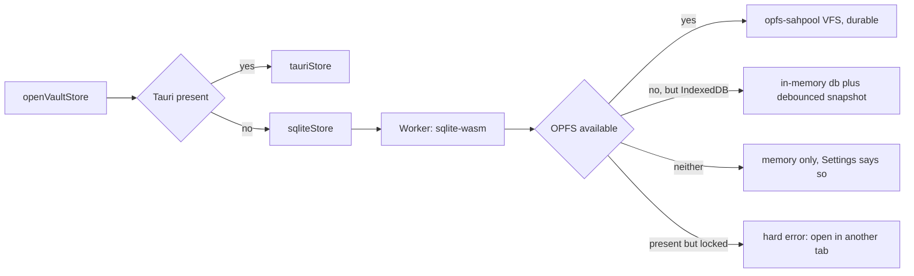
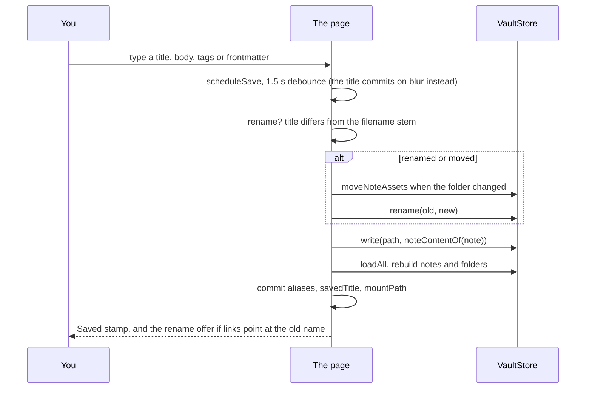

# The vault

A vault is a virtual filesystem of Markdown notes. Paths are the identity:
`Work/Ideas/Big plan.md` is both where the note lives and what everything
else calls it. A top-level folder is a **notebook**, a root-level note is in
the **Pile**, and a note's images live beside it in `.assets/`. One interface
— `VaultStore` — has three implementations, so the browser build (sqlite-wasm)
and the desktop build (real files) share every line above it.

_Describes the code as of v0.1.0 (unreleased; schema v1) — verify against source when in doubt._

## File map

| Path | Role |
| --- | --- |
| [src/lib/vault/types.ts](../../src/lib/vault/types.ts) | `FileRow`, `Note`, `FolderEntry`, the `VaultStore` interface |
| [src/lib/vault/model.ts](../../src/lib/vault/model.ts) | Path algebra and the `FileRow` to `Note` conversion |
| [src/lib/vault/frontmatter.ts](../../src/lib/vault/frontmatter.ts) | YAML frontmatter: tolerant in, lossless out |
| [src/lib/vault/fmFields.ts](../../src/lib/vault/fmFields.ts) | The three field shapes the header edits: text, list, YAML |
| [src/lib/vault/sqlite-worker.ts](../../src/lib/vault/sqlite-worker.ts) | All SQL, the schema, the persistence tiers |
| [src/lib/vault/sqliteStore.ts](../../src/lib/vault/sqliteStore.ts) | Main-thread RPC proxy to that worker |
| [src/lib/vault/tauriStore.ts](../../src/lib/vault/tauriStore.ts) | Real `.md` files under `Documents/Notey` |
| [src/lib/vault/memoryStore.ts](../../src/lib/vault/memoryStore.ts) | In-memory store — and the contract's spec |
| [src/lib/vault/store.ts](../../src/lib/vault/store.ts) | The backend picker, one store per page |
| [src/lib/vault/assetStore.ts](../../src/lib/vault/assetStore.ts) | The editor's `AssetStore` over `.assets/` |
| [src/lib/vault/search.ts](../../src/lib/vault/search.ts) | The query grammar and scoring |

## The seam

```ts
export interface VaultStore {
  readonly backend: string;
  init(): Promise<void>;
  loadAll(): Promise<FileRow[]>;              // whole tree; asset bytes omitted
  read(path: string): Promise<FileRow | null>;
  list(prefix: string): Promise<FileRow[]>;   // subtree, asset bytes included
  write(file: FileWrite): Promise<FileRow>;   // creates missing parents
  mkdir(path: string): Promise<void>;
  rename(from: string, to: string): Promise<void>;  // subtree move; refuses a clash
  remove(path: string): Promise<void>;              // subtree delete
  getMeta(key: string): Promise<string | null>;
  setMeta(key: string, value: string): Promise<void>;
  usage?(): Promise<{ bytes: number } | null>;
  close?(): Promise<void>;
}
```

`loadAll` deliberately omits asset content: listing a vault must never carry
image bytes. `list` includes it, and is only ever called on one note's
`.assets/` directory.

[memoryStore.test.ts](../../src/lib/vault/memoryStore.test.ts) is the
contract's specification — implicit parents, subtree rename, clash refusal,
subtree delete. What passes there is what the other two must do.

## The three backends



`opfs-sahpool` rather than the default `opfs` VFS because the default needs
COOP/COEP headers GitHub Pages will not send. When OPFS exists but the pool
will not open, that is almost always a second tab holding the exclusive
handles — the worker raises instead of falling back, because falling back to
a different tier would fork the vault in two.

## Schema v1

`MIGRATIONS` in [sqlite-worker.ts](../../src/lib/vault/sqlite-worker.ts) is an
append-only array; `user_version` is its length. Never edit an entry — each
one describes the schema at that version forever.

```sql
CREATE TABLE files (
  path    TEXT PRIMARY KEY,
  kind    TEXT NOT NULL CHECK (kind IN ('dir','note','asset')),
  content TEXT,            -- markdown for notes, base64 for assets, NULL for dirs
  mime    TEXT,            -- assets only
  bytes   INTEGER,         -- assets only, decoded size
  mtime   TEXT NOT NULL    -- UTC ISO
);
CREATE TABLE meta (key TEXT PRIMARY KEY, value TEXT NOT NULL);
```

There is no notes table and no tags table: a note is a file, and its tags are
in its frontmatter. That is what keeps the two builds honest with each other
— the desktop build has only files to work with.

## Frontmatter

Tolerant on the way in, lossless on the way out.

- A `---` fence whose YAML does not parse, or does not parse to a **map**, is
  not frontmatter: the whole file is body. Never destroy prose because a
  fence lied.
- notey owns four keys — `created`, `updated`, `tags`, `aliases`. Everything
  else is kept verbatim, in its original position, and shown in the page
  header where it can be edited.
- Dates stay strings (the `yaml` package's YAML 1.2 core schema), so
  `created: 2026-08-31` round-trips as written rather than becoming a Date.

`buildNoteContent` rebuilds the block in the original key order, appends
newly-owned keys in canonical order, and omits `tags` and `aliases` when they
are empty.

### The three field shapes

Frontmatter is YAML, so a value can be a scalar, a sequence, or a whole
nested map. [fmFields.ts](../../src/lib/vault/fmFields.ts) offers one editor
per shape rather than pretending everything is a string:

| Kind | Holds | Edited as |
| --- | --- | --- |
| `text` | a string, number, boolean or date | one line |
| `list` | a sequence of scalars | comma-separated, like tags |
| `yaml` | a map, a list of maps, anything nested | the YAML itself |

`kindOf` picks the shape when a note is opened; one button cycles it
(text → list → YAML → text). Two rules make this safe:

- **An untouched value round-trips as the object it was.** `fromFields`
  compares each field against `displayValue(original)` and, when they match,
  writes the original back — so `port: 8080` stays a number and a nested map
  keeps its ordering even though nothing here can render it.
- **A YAML field that will not parse keeps its previous value** and is
  reported under the block, rather than being written as a broken string.

`aliases` is one of these fields now (a list), so it can be edited and
emptied by hand; a rename adds to it rather than being its only source.

## Paths

`sanitizeTitle` swaps the characters no filesystem takes for `-` and keeps
spaces and unicode, because the desktop build writes these names to a real
disk and files belong to people. `uniqueNotePath` dodges clashes
case-insensitively (` 2`, ` 3`, …), because the disks it writes to are.

## A save, end to end



## Writes, and exactly when

| Action | Writes |
| --- | --- |
| Opening the app | nothing |
| Typing on the unfiled page | `localStorage` only (`notey-scratch`) |
| Typing in a note | that note's file, 1.5 s after you stop |
| Editing the title | nothing until you leave the field or press Enter |
| Committing a title | renames the file; pushes the old title into `aliases`, unless the note had never been named |
| Changing "inside" | renames the file into the new folder; moves its assets |
| Editing tags or a frontmatter field | that note's file |
| Pasting an image | one file in `<folder>/.assets/`, then the note |
| "File this note" | one new note file; clears the scratch |
| Bulk tag, move or delete | one write per **changed** row, nothing for the rest |
| Deleting a notebook | one rename per note and subfolder inside, then the folder |
| Any export | nothing |

## Assets

Markdown carries a relative ref — `` — so an exported
or synced `.md` file keeps working in any other tool. `resolve()` must be
synchronous (Crepe calls it while rendering an image node), so the store is
**primed** once per note before the editor mounts, and answers from that
cache. Each asset is capped at 2 MB.

Assets are collected when they stop being referenced by any note in their
folder: deleting a note removes the assets no sibling still uses, and moving
a note copies its assets to the destination (renaming on a clash) and removes
the originals unless a sibling still references them.

## Known limits and decisions

- **`loadAll` after every write.** Simple and always correct; it is also a
  full re-read of every note body. The first thing to change if a vault gets
  big.
- **No transactions across notes.** A bulk action is a loop of writes; an
  interruption leaves some done. The receipt line says how many.
- **`meta` is barely used.** It exists so a future schema has somewhere to
  keep vault-level state; preferences deliberately live per-device in
  `localStorage`, not in the vault.
- **One browser tab holds the vault at a time, and it is not a choice.**
  The sqlite SAH-pool VFS needs the OPFS sync-access-handle API, which
  exists only in dedicated workers; a SharedWorker can neither use it nor
  start a dedicated worker that could (Chrome does not define `Worker` in
  that scope). Tabs therefore hand the vault over rather than share it —
  see [ui.md](ui.md) for what that looks like — and two tabs writing to one
  note is impossible by construction rather than by a lock.
- **The Tauri store ignores files it does not understand.** A stray `.txt` is
  invisible to notey but rides along on a folder rename and goes down with a
  folder delete, because those act on the real directory.
