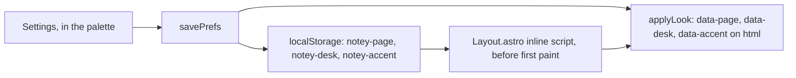

# Design system

A card index rendered in a browser: cream stock on an aged desk, a typewriter
face, one red rule under every header, and a fountain-pen blue for anything
you can follow. The token **names** are `useful`'s — that is what let a
4,800-line editor stack port without restyling — and only the values are
notey's.

_Describes the code as of v0.1.0 (unreleased; schema v1) — verify against source when in doubt._

## File map

| Path | Role |
| --- | --- |
| [src/styles/theme.css](../../src/styles/theme.css) | Every design token: the scale, the papers, the desks, the pens |
| [src/styles/global.css](../../src/styles/global.css) | Reset, base elements, utility classes, `.prose`, Prism inks, print |
| [public/fonts/](../../public/fonts/) | Courier Prime, vendored, with `PROVENANCE.txt` |
| [src/layouts/Layout.astro](../../src/layouts/Layout.astro) | The pre-paint look script |
| [src/lib/prefs.ts](../../src/lib/prefs.ts) | `applyLook`, the swatch lists, the stored choices |
| [src/components/SettingsPanel.svelte](../../src/components/SettingsPanel.svelte) | Where the choices are made — inside the palette |

## Three independent choices

Three attributes on `<html>`, set before first paint by the script in
`Layout.astro` and re-applied by `prefs.applyLook` when a setting changes:

| Attribute | Chooses | Values |
| --- | --- | --- |
| `data-page` | the **paper** — the sheet, its ink, and the chrome that must stay legible on it | `light` (card), `dark` (lamplight), `plain`, `legal`, `blueprint`, `blueprint-inverse`, `black` |
| `data-desk` | the **desk** the sheet lies on | `plain-light`, `plain-dark`, `wood-mahogany`, `wood-oak`, `wood-birch`, `leather-black`, `leather-rich`, `leather-tan`, `leather-cream` |
| `data-accent` | the **pen** — buttons, links, focus | `ink`, `oxblood`, `forest`, `teal`, `aubergine`, `rust`, `slate`, `moss` |
| `data-grain` | how large the desk's texture is drawn | `fine`, `medium`, `coarse` |
| `data-rule` | the red rule under the page header | `on`, `off` |

They are independent because "the page is light" and "the desk is dark" have
to be sayable at the same time. That is why nothing uses `light-dark()` any
more: one function cannot answer two questions.

`system` for either resolves at boot — the paper from
`prefers-color-scheme`, the desk to the plain one that matches it.

## Paper and desk are different surfaces

- Paper tokens (`--surface-color`, `--text-color`, `--border-color`, the
  feedback colours, the shadows) live in the `[data-page]` blocks. The
  palette, dialogs and inputs all sit on paper, so they follow it.
- Desk tokens live in the `[data-desk]` blocks: `--bg-color` (a flat colour
  anything can paint over itself to be certain of its background),
  `--desk-layers` / `--desk-blend` / `--desk-size` (the texture, painted on
  `body` only), and `--desk-ink` / `--desk-ink-muted` for the few things
  that sit **out on the desk** rather than on the page — the book and the
  boot line. A light page on a dark desk would otherwise hide them.

## The textures are generated, not downloaded

`--tex-grain`, `--tex-knot`, `--tex-pebble` and `--tex-creases` are inline
SVG data URIs built from `feTurbulence`. Two ideas do all the work:

- **Wood**: turbulence stretched along one axis (`baseFrequency: 0.55 0.008`)
  makes long streaks. The grain must run the same way as the plank lines
  over it, or the result reads as corrugated iron — that was the first
  attempt.
- **Leather**: `feDiffuseLighting` over turbulence lights a noise field from
  one side, which is what makes a surface look pebbled rather than noisy. A
  `feComponentTransfer` pass adds the contrast that makes it read at a
  glance.

Each desk stacks those greys over a colour with `background-blend-mode`, so
one tile dresses every variant. `background-attachment: fixed` keeps the
desk still while the page scrolls.

They are tiles, so **`background-size` is the grain size**: `--grain-scale`
multiplies every desk's tile at once, and `data-grain` sets it to 0.4, 0.7
or 1. The default is the smallest, because at full size the leather read as
stucco rather than hide.

Some papers are *printed*, not just coloured: a legal pad's blue rules and
red margin, a blueprint's two-scale grid. Those are painted by `.sheet`'s
`::before` (and `::after` for the margin) from `--paper-lines` and
`--paper-grid`, so no ported component needs to know which paper it is on.

**The palette never sits on a texture.** Its panel is `--surface-raised-color`
— a solid paper colour — so legibility does not depend on which desk is
underneath.

## Three inks and a stamp

| Role | Token | Light paper | Dark paper |
| --- | --- | --- | --- |
| Ink — what the typewriter left | `--text-color` | `#221e16` | `#e8e1cd` |
| Pencil — annotations | `--text-muted-color` | `#6f654c` | `#a89c7d` |
| Pen — links and actions | `--color-primary` | the accent | the accent, lifted toward the ink |
| Stamp — the red rule, eyebrows, focus | `--color-stamp` | `#a8352c` | `#cf7466` |

The pen is the one the reader picks. Each swatch supplies only
`--accent-base` and `--accent-on`; `--color-primary-strong` and
`--color-primary-soft` are mixed from it and the paper with `color-mix`, so
eight swatches times two papers is sixteen coherent palettes from sixteen
numbers. On dark paper the base is mixed 52% toward the ink, because a pen
chosen for paper is a bruise under lamplight.

Lines come in two weights: `--border-color` is decorative,
`--border-strong-color` identifies a control. Feedback
(`--color-success`, `--color-danger`, `--color-warning`) is never the stamp
red — feedback must not read as brand.

Two tokens are notey's own: `--rule-color` (the red rule, an alias of the
stamp) and `--ruled-line-color` (the faint blue of a printed pad).

## The rest of the scale

- **Type**: `--font-body` is Courier Prime with the system Couriers behind
  it; `--font-mono` is an alias, so code and readouts can ask for "the mono
  face" by name. Sizes `sm | base | lg | xl | 2xl`, line-height 1.6.
- **Annotation voice**: `--font-size-eyebrow` (0.7rem) with
  `--tracking-label` (0.18em), uppercase — the `ACC. NO. 0001` register,
  applied with `.eyebrow`.
- **Spacing**: `--space-1` … `--space-6`, 0.2rem to 2rem.
- **Shape**: small radii (2/4/6px) — index cards have gently rounded corners,
  unlike useful's drafting sheets, which had none.
- **Elevation**: `--shadow-1` for a sheet just off the desk, `--shadow-2` for
  dialogs.
- **Layout**: `--page-max-width`, `--navbar-height`, `--sidebar-width` (kept
  as a token although notey has no sidebar; ported components reference it).

## The red rule

```css
.red-rule {
  border-top: 2px solid var(--rule-color);
  border-bottom: 1px solid var(--rule-color);
  height: 3px;
  margin: 0 calc(-1 * var(--space-6)) var(--space-4);
}
```

A double line, heavy over light, bled to both edges of the sheet by negative
margins — the head of an index card. Above it: the title on the left, the
frontmatter on the right. Below it: the writing. Nothing else uses the rule
colour except the save stamp when it fails and the eyebrow accent.

## The utility contract

The ported components assume these exist: `.btn`, `.btn-primary`,
`.btn-danger`, `.btn-sm`, `.stack`, `.stack.tight`, `.row`, `.row.wrap`,
`.muted`, `.eyebrow`, `.eyebrow-stamp`, `.prose`, `.print-only`, the
`.token.*` Prism inks, and the `[data-print="hide"]` print rule. Changing a
name here breaks the editor stack silently — add, do not rename.

## Applying a choice



The three mirrors are bare strings rather than the preferences blob, so the
pre-paint script is a few lines and cannot throw on a half-written value.
It runs before anything renders, so there is no flash of the wrong paper.

## Fonts

Courier Prime (SIL OFL 1.1), four latin-subset faces, vendored into
`public/fonts/` by [tools/build-courier-prime.mjs](../../tools/build-courier-prime.mjs)
with bytes and SHA-256 recorded in `PROVENANCE.txt`. Vendored rather than
linked because the app must work offline and must not phone Google Fonts; the
service worker keeps them in a bucket that survives a cache version bump.

## Known limits and decisions

- **One typeface for everything.** A typewriter has one face; headings differ
  by size and weight, not by family.
- **Contrast is checked by eye, not by a sweep.** useful has an automated
  a11y contrast test; notey does not yet — usability first, per the plan.
  With eight pens times two papers the combinations now outrun the eye, so
  this is the first thing to automate.
- **A textured desk is a few hundred KB of filter work at paint time.** It
  is painted once on `body` with `background-attachment: fixed`; scrolling
  does not re-run it. Plain desks cost nothing.
- **`--sidebar-width` survives with no sidebar** because ported components
  still read it. Harmless, and removing it means editing files that are
  otherwise verbatim.
