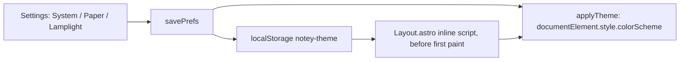

# Design system

A card index rendered in a browser: cream stock on an aged desk, a typewriter
face, one red rule under every header, and a fountain-pen blue for anything
you can follow. The token **names** are `useful`'s — that is what let a
4,800-line editor stack port without restyling — and only the values are
notey's.

_Describes the code as of v0.1.0 (unreleased; schema v1) — verify against source when in doubt._

## File map

| Path | Role |
| --- | --- |
| [src/styles/theme.css](../../src/styles/theme.css) | Every design token, both themes, in one `:root` |
| [src/styles/global.css](../../src/styles/global.css) | Reset, base elements, utility classes, `.prose`, Prism inks, print |
| [public/fonts/](../../public/fonts/) | Courier Prime, vendored, with `PROVENANCE.txt` |
| [src/layouts/Layout.astro](../../src/layouts/Layout.astro) | The pre-paint theme pin |
| [src/lib/prefs.ts](../../src/lib/prefs.ts) | `applyTheme` and the stored choice |

## Two sheets

One `:root` block using `light-dark()`, with `color-scheme: light dark`.
There is no `[data-theme]` attribute anywhere: a manual choice is applied by
pinning `document.documentElement.style.colorScheme`.

- **light** — typewriter ink on cream card stock, on an aged-paper desk.
- **dark** — the same desk by lamplight: everything warm and dimmed, never
  cold slate.

## Three inks and a stamp

| Role | Token | Light | Dark |
| --- | --- | --- | --- |
| Ink — what the typewriter left | `--text-color` | `#221e16` | `#e8e1cd` |
| Pencil — annotations | `--text-muted-color` | `#6f654c` | `#a89c7d` |
| Pen — links and actions | `--color-primary` | `#28439c` | `#9db1ee` |
| Stamp — the red rule, eyebrows, focus | `--color-stamp` | `#a8352c` | `#cf7466` |

Surfaces are the desk (`--bg-color`), the page (`--surface-color`) and a card
lifted off it (`--surface-raised-color`). Lines come in two weights:
`--border-color` is decorative, `--border-strong-color` identifies a control.
Feedback (`--color-success`, `--color-danger`, `--color-warning`) is never the
stamp red — feedback must not read as brand.

Two tokens are notey's own: `--rule-color` (the red rule, an alias of the
stamp) and `--ruled-line-color` (the faint blue of a printed pad).

## The rest of the scale

- **Type**: `--font-body` is Courier Prime with the system Couriers behind
  it; `--font-mono` is an alias, so code and readouts can ask for "the mono
  face" by name. Sizes `sm | base | lg | xl | 2xl`, line-height 1.6.
- **Annotation voice**: `--font-size-eyebrow` (0.7rem) with
  `--tracking-label` (0.18em), uppercase — the `ACC. NO. 0001` register,
  applied with `.eyebrow`.
- **Spacing**: `--space-1` … `--space-6`, 0.2rem to 2rem.
- **Shape**: small radii (2/4/6px) — index cards have gently rounded corners,
  unlike useful's drafting sheets, which had none.
- **Elevation**: `--shadow-1` for a sheet just off the desk, `--shadow-2` for
  dialogs.
- **Layout**: `--page-max-width`, `--navbar-height`, `--sidebar-width` (kept
  as a token although notey has no sidebar; ported components reference it).

## The red rule

```css
.red-rule {
  border-top: 2px solid var(--rule-color);
  border-bottom: 1px solid var(--rule-color);
  height: 3px;
  margin: 0 calc(-1 * var(--space-6)) var(--space-4);
}
```

A double line, heavy over light, bled to both edges of the sheet by negative
margins — the head of an index card. Above it: the title on the left, the
frontmatter on the right. Below it: the writing. Nothing else uses the rule
colour except the save stamp when it fails and the eyebrow accent.

## The utility contract

The ported components assume these exist: `.btn`, `.btn-primary`,
`.btn-danger`, `.btn-sm`, `.stack`, `.stack.tight`, `.row`, `.row.wrap`,
`.muted`, `.eyebrow`, `.eyebrow-stamp`, `.prose`, `.print-only`, the
`.token.*` Prism inks, and the `[data-print="hide"]` print rule. Changing a
name here breaks the editor stack silently — add, do not rename.

## The theme pin



The inline script runs before anything renders, so there is no flash of the
wrong sheet. "System" removes the key and clears the inline style, which
hands the choice back to `light-dark()`.

## Fonts

Courier Prime (SIL OFL 1.1), four latin-subset faces, vendored into
`public/fonts/` by [tools/build-courier-prime.mjs](../../tools/build-courier-prime.mjs)
with bytes and SHA-256 recorded in `PROVENANCE.txt`. Vendored rather than
linked because the app must work offline and must not phone Google Fonts; the
service worker keeps them in a bucket that survives a cache version bump.

## Known limits and decisions

- **One typeface for everything.** A typewriter has one face; headings differ
  by size and weight, not by family.
- **Contrast is checked by eye, not by a sweep.** useful has an automated
  a11y contrast test; notey does not yet — usability first, per the plan.
- **`--sidebar-width` survives with no sidebar** because ported components
  still read it. Harmless, and removing it means editing files that are
  otherwise verbatim.
