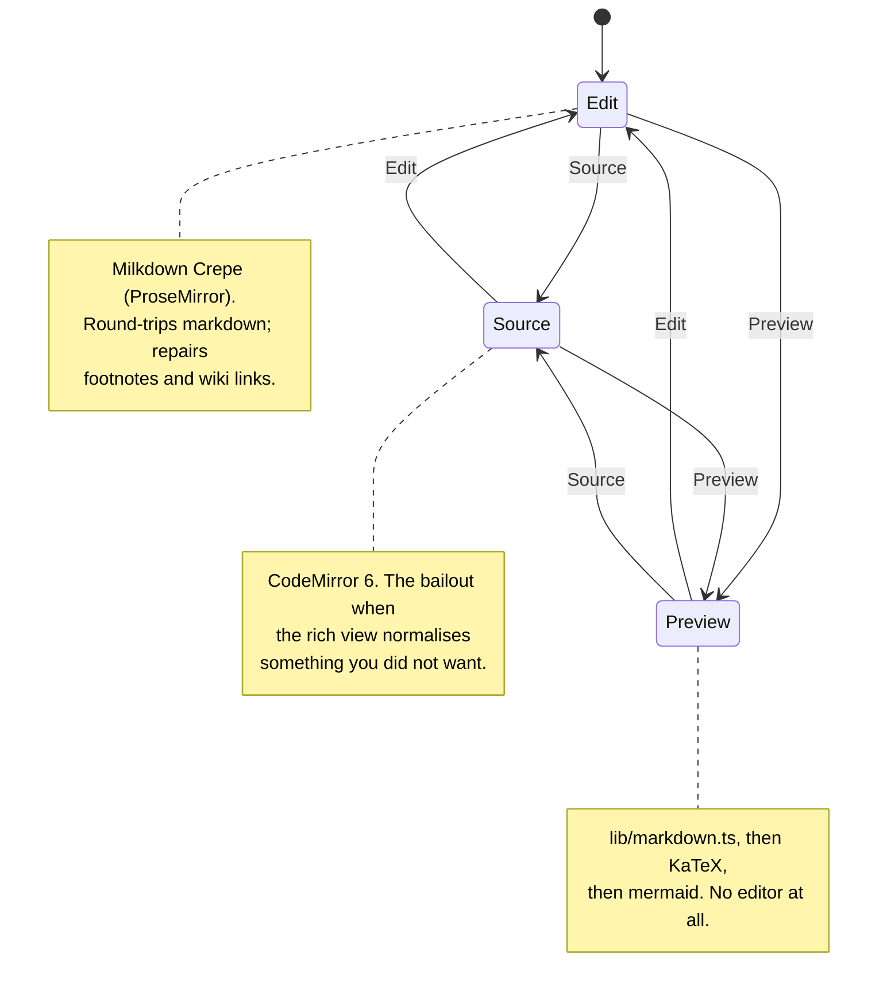

# The editor

One markdown string, three faces over it, and four dialogs hanging off the
toolbar. The whole stack is ported from `useful`'s notebook — the component
contracts, the footnote repairs and the asset seam are unchanged; the import
paths, the tokens and two fixed bugs are notey's.

_Describes the code as of v0.1.0 (unreleased; schema v1) — verify against source when in doubt._

## File map

| Path | Role |
| --- | --- |
| [MarkdownEditor.svelte](../../src/components/notebook/MarkdownEditor.svelte) | The chassis: three faces, the toolbar, the change plumbing |
| [MarkdownPreview.svelte](../../src/components/notebook/MarkdownPreview.svelte) | The rendered face; KaTeX and mermaid passes |
| [FootnoteDialog.svelte](../../src/components/notebook/FootnoteDialog.svelte) | Writing the notes at the foot |
| [DiagramDialog.svelte](../../src/components/notebook/DiagramDialog.svelte) | The mermaid workbench |
| [DrawingDialog.svelte](../../src/components/notebook/DrawingDialog.svelte) | Excalidraw in a Svelte dialog |
| [src/lib/markdown.ts](../../src/lib/markdown.ts) | marked + DOMPurify + Prism, wiki links, footnotes, maths, mermaid |
| [src/lib/notebook/footnotes.ts](../../src/lib/notebook/footnotes.ts) | Pure, offset-preserving footnote model |
| [src/lib/notebook/mermaid.ts](../../src/lib/notebook/mermaid.ts) | Lazy engine, templates, completions |
| [src/lib/notebook/drawing.ts](../../src/lib/notebook/drawing.ts) | Excalidraw loading, PNG with the scene inside |
| [src/lib/notebook/math.ts](../../src/lib/notebook/math.ts) | Lazy KaTeX over `[data-math]` |

## Three faces, one string



A face switch destroys the current editor and mounts the next from the live
string. The text carries over; the undo stack does not. The face is
remembered in preferences.

## The change plumbing

```
keystroke
  → Milkdown coalesces ~200 ms
  → emit() debounces `debounce` ms (the app passes 150)
  → onChange(md)
  → NoteyApp.onBodyChange → body = md, scheduleSave() 1.5 s
  → doSave() writes the file
```

`flush()` collapses all of it synchronously: it reads the canvas back with
`syncFromCanvas()` first, then drains the timer. The app calls it before
every switch, export and bulk action, and on pagehide.

Cross-document safety: `onChange` carries no note id — `NoteyApp` reads
`mountPath` at call time, which openNote sets after flushing the previous
editor and which a rename updates in place. A flush that arrives while an
editor is being destroyed therefore writes to the note that editor belonged
to.

## Footnotes

Milkdown's GFM preset parses `[^x]` references but has **no schema node for
definitions**, so a round-trip through the rich view would drop every
`[^x]: …` line. Three repairs make it safe:

1. `restoreDefinitions(before, after)` re-appends definitions the round-trip
   lost, on every `markdownUpdated`.
2. `unescapeFootnotes` / `unescapeDoubleBrackets` undo remark-stringify's
   escaping of `[^a]` and `[[wiki]]`.
3. `harvestFootnotes()` deletes definition nodes from the canvas (unless the
   caret is inside one) with `addToHistory: false`, so the notes live in the
   markdown and in the dialog, never in the prose.

**Alt+0** is claimed on the **capture phase of the editor root**, not with an
`onkeydown` on the element: a real keypress inside the ProseMirror canvas
never reached that handler, because the editors consume Alt-combinations on
the way up. A synthetic event did arrive, which is exactly why the bug
survived a port. The dialog, in turn, ignores keys until a task boundary
after it mounts — its window listener is registered while the opening
keystroke is still being dispatched, and without the guard Alt+0 opened and
instantly closed it.

## Diagrams

` ```mermaid ` fences. In the rich view Crepe's code-block preview renders
them in place; in Preview, `renderInto()` swaps each `pre.mermaid` for its
SVG, keyed on `data-mermaid-source` so a re-render is idempotent. The
workbench (◇ Diagram) has eight templates, completions that know the diagram
type from line 1, a 350 ms debounced preview that keeps the last good picture
while you fix a broken one, Ctrl/Cmd+Enter to save and Escape to cancel. In
Source mode, opening it with the cursor inside a fence edits that fence.

The engine is a lazy `import('mermaid')` — about a megabyte, paid on the
first diagram and never before.

## Drawings

✏ Draw mounts Excalidraw (React, lazily, with its fonts served from
`public/excalidraw/`) inside a Svelte dialog: `createRoot` in `onMount`,
`unmount` in `onDestroy`, and `collaborators: []` forced into the initial
state or Excalidraw crashes on a Map-shaped field. Saving exports a PNG with
`exportEmbedScene: true` at 2× scale — the scene rides inside the image, so
the file reopens for editing, and it is an ordinary PNG to everything else.
Drawings are recognised by the `.excalidraw.png` suffix, which
`uniqueAssetName` treats as one compound extension so a clash becomes
`drawing-2.excalidraw.png` rather than breaking the suffix.

## Images and maths

Paste or drop an image and `AssetStore.save()` writes it to the note's
`.assets/` and returns the relative ref. Over 2 MB it is refused with the
size and the limit in the message.

`$…$` and `$$…$$` follow remark-math's rules, so `$5 and $10` stays prose.
The rich view renders maths through Crepe's LaTeX feature; Preview emits
`data-math` nodes that `renderMathIn` typesets with a lazily imported KaTeX.
The stylesheet and faces are vendored in `public/math/` rather than pulled
from the package, which would drag in sixty hashed font files.

## Known limits and decisions

- **A face switch loses undo history.** Each face starts fresh; only the text
  carries over.
- **The rich view normalises markdown.** That is the price of a real WYSIWYG
  over ProseMirror; Source is the escape hatch, and
  [far-fetched.md](plans/far-fetched.md) records why a lossless serializer was
  not attempted.
- **Footnote definitions are hidden in the rich view on purpose.** They are
  not prose. They are in Source and in the dialog.
- **The editor chunk is large.** Crepe, ProseMirror, Vue's runtime and KaTeX
  land together on first load; mermaid and Excalidraw stay behind their
  buttons.
