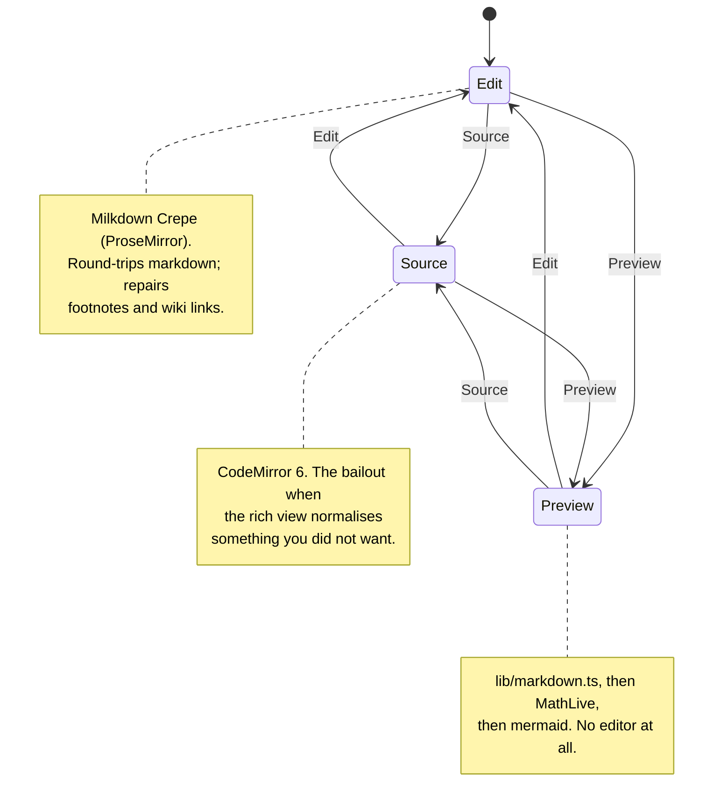
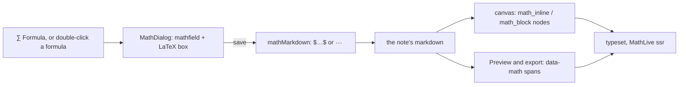

# The editor

One markdown string, three faces over it, and five dialogs hanging off the
toolbar. The whole stack is ported from `useful`'s notebook — the component
contracts, the footnote repairs and the asset seam are unchanged; the import
paths, the tokens and two fixed bugs are notey's.

_Describes the code as of v0.1.0 (unreleased; schema v1) — verify against source when in doubt._

## File map

| Path | Role |
| --- | --- |
| [MarkdownEditor.svelte](../../src/components/notebook/MarkdownEditor.svelte) | The chassis: three faces, the toolbar, the change plumbing |
| [MarkdownPreview.svelte](../../src/components/notebook/MarkdownPreview.svelte) | The rendered face; maths and mermaid passes |
| [MathDialog.svelte](../../src/components/notebook/MathDialog.svelte) | The formula editor: a MathLive mathfield |
| [FootnoteDialog.svelte](../../src/components/notebook/FootnoteDialog.svelte) | Writing the notes at the foot |
| [DiagramDialog.svelte](../../src/components/notebook/DiagramDialog.svelte) | The mermaid workbench |
| [DrawingDialog.svelte](../../src/components/notebook/DrawingDialog.svelte) | Excalidraw in a Svelte dialog |
| [src/lib/markdown.ts](../../src/lib/markdown.ts) | marked + DOMPurify + Prism, wiki links, footnotes, maths, mermaid |
| [src/lib/notebook/footnotes.ts](../../src/lib/notebook/footnotes.ts) | Pure, offset-preserving footnote model |
| [src/lib/notebook/mermaid.ts](../../src/lib/notebook/mermaid.ts) | Lazy engine, templates, completions |
| [src/lib/notebook/drawing.ts](../../src/lib/notebook/drawing.ts) | Excalidraw loading, PNG with the scene inside |
| [src/lib/notebook/math.ts](../../src/lib/notebook/math.ts) | Lazy MathLive renderer; `typeset` and `renderMathIn` |
| [src/lib/notebook/mathNode.ts](../../src/lib/notebook/mathNode.ts) | The canvas's maths nodes, in place of Crepe's |
| [src/lib/notebook/mathText.ts](../../src/lib/notebook/mathText.ts) | Pure: find a formula in source, write one back, money vs maths |
| [src/lib/notebook/shortcuts.ts](../../src/lib/notebook/shortcuts.ts) | Pure: the four tools, their keys, and how a keypress is read |

## Three faces, one string



A face switch destroys the current editor and mounts the next from the live
string. The text carries over; the undo stack does not. The face is
remembered in preferences.

## The change plumbing

```
keystroke
  → Milkdown coalesces ~200 ms
  → emit() debounces `debounce` ms (the app passes 150)
  → onChange(md)
  → NoteyApp.onBodyChange → body = md, scheduleSave() 1.5 s
  → doSave() writes the file
```

`flush()` collapses all of it synchronously: it reads the canvas back with
`syncFromCanvas()` first, then drains the timer. The app calls it before
every switch, export and bulk action, and on pagehide.

Cross-document safety: `onChange` carries no note id — `NoteyApp` reads
`mountPath` at call time, which openNote sets after flushing the previous
editor and which a rename updates in place. A flush that arrives while an
editor is being destroyed therefore writes to the note that editor belonged
to.

## Footnotes

Milkdown's GFM preset parses `[^x]` references but has **no schema node for
definitions**, so a round-trip through the rich view would drop every
`[^x]: …` line. Three repairs make it safe:

1. `restoreDefinitions(before, after)` re-appends definitions the round-trip
   lost, on every `markdownUpdated`.
2. `unescapeFootnotes` / `unescapeDoubleBrackets` / `unescapeDollars` undo
   remark-stringify's escaping of `[^a]`, `[[wiki]]` and `$` in prose.
3. `harvestFootnotes()` deletes definition nodes from the canvas (unless the
   caret is inside one) with `addToHistory: false`, so the notes live in the
   markdown and in the dialog, never in the prose.

The footnote dialog ignores keys until a task boundary after it mounts — its
window listener is registered while the opening keystroke is still being
dispatched, and without the guard the shortcut opened and instantly closed
it. It closes on whatever key opened it, which is passed in as `closeKey`
rather than hard-coded, so a rebound shortcut still works both ways.

**A citation goes after what it cites.** `citeFootnote` collapses the
selection to its end before inserting: `replaceSelectionWith` replaces, so
citing a sentence somebody had selected used to DELETE that sentence and
leave the little number where it had been. Source view inserts at
`selection.main.to` for the same reason.

## Shortcuts and the palette

Every tool on the toolbar is reachable three ways: the button, a key, and a
command in the palette. The keys are a preference
([shortcuts.ts](../../src/lib/notebook/shortcuts.ts)):

| Tool | Key |
| --- | --- |
| Formula | `Alt+F` |
| Diagram | `Alt+M` |
| Draw | `Alt+E` |
| Footnotes | `Alt+0` |

- **`TOOLS` is one list**, and the toolbar, the palette rows and the
  Settings rows all read it, so they cannot drift apart.
- **The keys are claimed on the CAPTURE phase of the editor root**, not with
  an `onkeydown` on the element: a real keypress inside the ProseMirror
  canvas never reached that handler, because the editors consume
  Alt-combinations on the way up. A synthetic event did arrive, which is
  exactly why that bug survived a port. A dialog that is already open keeps
  its own keys — the handler stands down while one is up.
- **A keypress is matched on `event.code`**, with `event.key` only as a
  fallback. macOS reports `key: 'ƒ'` for Alt+F and `'º'` for Alt+0, so a
  `key` comparison stops working the moment somebody holds Option. (The
  footnote shortcut already did this for `Digit0`.)
- **A bind needs Ctrl, Alt or Cmd.** Shift alone is not enough: a tool bound
  to `F` would open while you typed the word "off".
- **`openTool(id)` is exported**, which is how the palette reaches the
  dialogs — `NoteyApp` passes `onInsert` only when a face can take an
  insertion, so the four commands are absent in Preview.
- **The button wears its key** in a `<kbd>`, and the tooltip repeats it.
  Both read the live preference, so a rebinding shows up at once; they are
  hidden under 44rem, where there is no keyboard to press them with.
- `readShortcuts` is what makes a hand-edited preference safe: anything
  unreadable, reserved (`Ctrl+K` is the palette) or already taken falls back
  to the default, so no tool can be left unreachable.

## Diagrams

` ```mermaid ` fences. In the rich view Crepe's code-block preview renders
them in place; in Preview, `renderInto()` swaps each `pre.mermaid` for its
SVG, keyed on `data-mermaid-source` so a re-render is idempotent. The
workbench (◇ Diagram) has eight templates, completions that know the diagram
type from line 1, a 350 ms debounced preview that keeps the last good picture
while you fix a broken one, Ctrl/Cmd+Enter to save and Escape to cancel. In
Source mode, opening it with the cursor inside a fence edits that fence.

The engine is a lazy `import('mermaid')` — about a megabyte, paid on the
first diagram and never before.

## Drawings

✏ Draw mounts Excalidraw (React, lazily, with its fonts served from
`public/excalidraw/`) inside a Svelte dialog: `createRoot` in `onMount`,
`unmount` in `onDestroy`, and `collaborators: []` forced into the initial
state or Excalidraw crashes on a Map-shaped field. Saving exports a PNG with
`exportEmbedScene: true` at 2× scale — the scene rides inside the image, so
the file reopens for editing, and it is an ordinary PNG to everything else.
Drawings are recognised by the `.excalidraw.png` suffix, which
`uniqueAssetName` treats as one compound extension so a clash becomes
`drawing-2.excalidraw.png` rather than breaking the suffix.

## Images

Paste or drop an image and `AssetStore.save()` writes it to the note's
`.assets/` and returns the relative ref. Over 2 MB it is refused with the
size and the limit in the message.

## Maths

Maths is written in a **MathLive mathfield** and stored as ordinary
`$…$` / `$$…$$` markdown. One engine does all of it — the mathfield you
write in, the canvas, the Preview and the HTML export — so a formula cannot
look one way while you write it and another once you stop. It used to be
KaTeX for reading and a LaTeX text box for writing.



**The dialog** ([MathDialog.svelte](../../src/components/notebook/MathDialog.svelte)).
∑ Formula opens it; so does double-clicking a formula in the canvas, and in
Source view the button opens on the formula the cursor is in
(`mathAt`, which knows `$…$`, `$$…$$` on one line or several, and ` ```math `
fences). The mathfield and a LaTeX box edit each other. A shelf of eight
buttons covers what people reach for constantly; everything else is on
MathLive's own keyboard or a typed shortcut. "On its own line" switches
between `$…$` and `$$…$$`. The matrix button is the one that asks first: a
rows × columns picker (1–10 each, `MATRIX_MAX`) whose answer `matrixLatex`
turns into a `pmatrix` with `#0` in the first cell and `#?` everywhere else,
so the cells are filled by typing and Tab. It used to insert a fixed 2 × 2,
and growing that meant MathLive's context menu one row at a time. Escape
closes the picker before it closes the dialog.

Four settings in it are load-bearing:

- **The inline shortcuts are left ON.** "sqrt" becomes a radical and "pi"
  becomes π — that is the whole reason this is easier than LaTeX. (useful's
  napkin editor turns them off because its variables are words like
  `costPerMonth`; here they are `x` and `n`.)
- **`soundsDirectory = null`**: the keypress `.wav` files are not vendored.
- **`fontsDirectory = null`**: the vendored stylesheet's
  `--ML__static-fonts` rule hands the faces to the browser, which fetches
  the two a formula uses instead of all twenty.
- **"Ready" means the keyboard has arrived**, not that the element exists.
  MathLive builds the field after `mount` and moves focus into it about
  35 ms after that; a key in between went to the dialog and was lost. The
  "Loading…" line now stays until `focusin`.

Escape belongs to the mathfield while it has focus — MathLive uses it to
leave its `\command` entry — and closes the dialog only from outside it.

**The canvas** ([mathNode.ts](../../src/lib/notebook/mathNode.ts)). Crepe's
own LaTeX feature is switched **off**: it draws with KaTeX, edits with a
text box, and turns `$$…$$` into a code block. notey's nodes replace it:

- `remark-math` still parses and serializes — it is the plugin
  remark-stringify needs to write `$…$` and `$$…$$` back out.
- `math_inline` and `math_block` are **atoms**: no caret inside a formula,
  because editing one is the dialog's job. One click selects (so a formula
  can be deleted or dragged), a double-click edits.
- `toDOM` puts the LaTeX in `data-value` and draws through `typeset`, which
  shows the source until the engine arrives and then swaps in the markup.
- An edit is a **cut and an insert by position** (`cutMathAt`), not a
  replace-the-selection: the browser's own double-click sets a DOM selection
  that ProseMirror reads back as a text selection the moment the editor is
  focused again, and the edited formula was appended at the end of the
  paragraph instead of replacing the old one. Going from inline to display
  also takes the space after the formula, or remark writes the half-sentence
  that follows as `&#x20;is famous.`
- `$…$` typed straight into the canvas still becomes a formula (an input
  rule), for anyone who would rather write LaTeX.

**Money is not maths.** micromark's maths is looser than the rule notey
renders by — it strips a space from each side the way a code span does, so
`$12 and $15` parses as a formula reading "12 and". `strictMathPlugin` walks
the tree after remark-math and turns anything `looksLikeMath` rejects back
into the exact source text, so the canvas and Preview agree about prices.
Then, because remark-stringify escapes every `$` in prose once maths is on,
`unescapeDollars` puts them back — code spans and fences excepted, where a
`\$` is the author's. Before this, `costs $7` typed in the canvas was saved
as `costs \$7`; that predates MathLive.

**Reading** ([math.ts](../../src/lib/notebook/math.ts)). Preview and the
export emit `data-math` nodes that `renderMathIn` typesets with
`convertLatexToMarkup` from MathLive's **`ssr` entry** — the LaTeX engine
without the editor, half the size, lazily imported. Inline maths is set in
text style (`\textstyle`), because MathLive's default is display style and
a sum in a sentence would stack its limits and push the line apart.

The stylesheets and faces are vendored in `public/math/`
(`tools/build-math-assets.mjs`): `mathlive-fonts.css` and the twenty faces
verbatim, and `mathlive-static.css` — the layout rules for markup without an
editor — with its duplicate `@font-face` blocks stripped.

### The drawing dialog keeps two habits the others drop

Excalidraw is an application, not a form, so this one modal behaves
differently on purpose
([DrawingDialog.svelte](../../src/components/notebook/DrawingDialog.svelte)):

- **Escape does not close it.** Excalidraw needs that key — it finishes a
  multi-point line, drops a selection, leaves the current tool. A dialog
  that closes on Escape takes the key away from the canvas *and* discards
  the drawing at the same time. Cancel and × close it.
- **The keyboard is Excalidraw's while it is open.** By default Excalidraw
  binds its shortcuts to its own container, not the document
  (`handleKeyboardGlobally` is off), so a key only reaches it while focus
  is inside its React root — and nothing had put it there. The caret
  stayed in the note behind, so `5` typed "5" into what you were writing;
  once the note was blurred, focus sat on the dialog's own div and Escape
  to finish a line went nowhere at all. The dialog now passes
  `handleKeyboardGlobally: true` (right for a modal: nothing else should be
  listening) and `autoFocus: true`, and blurs the note before the lazy
  chunk is even awaited. Focus goes back where it came from on close. The
  ✏ affordance on an existing drawing is the path that made the first
  half obvious: it is a click INSIDE the text, so the caret never left.
  In test mode the live Excalidraw API is exposed as
  `window.__noteyDrawing`, which is how the suite watches a line being
  drawn and sees Escape finish it.

## Known limits and decisions

- **A face switch loses undo history.** Each face starts fresh; only the text
  carries over.
- **The rich view normalises markdown.** That is the price of a real WYSIWYG
  over ProseMirror; Source is the escape hatch, and
  [far-fetched.md](plans/far-fetched.md) records why a lossless serializer was
  not attempted.
- **Footnote definitions are hidden in the rich view on purpose.** They are
  not prose. They are in Source and in the dialog.
- **The editor chunk is large.** Crepe, ProseMirror and Vue's runtime land
  together on first load; the MathLive renderer, the mathfield, mermaid and
  Excalidraw stay behind their first use. Everything is downloaded ahead of
  time anyway (see [service-worker-and-offline.md](service-worker-and-offline.md)).
- **KaTeX is still in the bundle, unused.** Crepe imports it statically for
  the LaTeX feature notey switches off, so the bundler cannot drop it. A
  Vite alias to a stub would, and was not worth the trap it sets for whoever
  re-enables that feature.
- **A line that mixes a lone price with real maths** — `costs $7 and
  $x^2$` — shows the maths as source text in the canvas. micromark pairs
  the first two dollars, `strictMathPlugin` hands that back as text, and the
  real formula's opening `$` has already been used up. The markdown is
  untouched and Preview renders it correctly.
- **`$$x$$` inside a sentence** is inline in the canvas and display in
  Preview (markdown.ts treats `$$` as display wherever it is). Rare, and the
  canvas writes it back as `$x$`.
