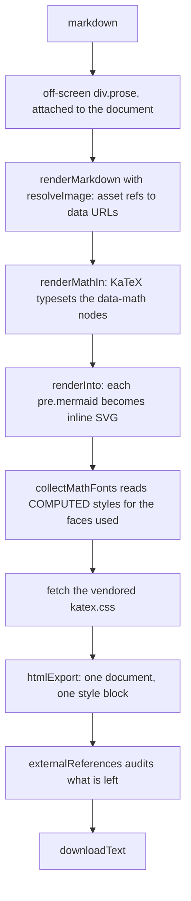

# Exporting

Three ways out for one note — Markdown, one self-contained HTML file, and the
browser's print dialog — and a zip for many. All four are ported from
`useful`'s notebook and are reached from the Ctrl+K palette.

_Describes the code as of v0.1.0 (unreleased; schema v1) — verify against source when in doubt._

## File map

| Path | Role |
| --- | --- |
| [src/lib/notebook/export.ts](../../src/lib/notebook/export.ts) | `markdownExport`, `NOTE_CSS`, `htmlExport`, `externalReferences`, `printDocument` |
| [src/lib/notebook/mathFonts.ts](../../src/lib/notebook/mathFonts.ts) | Which KaTeX faces a rendered note actually uses |
| [src/lib/zip.ts](../../src/lib/zip.ts) | A dependency-free stored-only zip writer |
| [src/lib/notebook/bulk.ts](../../src/lib/notebook/bulk.ts) | `exportFileName` — sanitising and clash suffixes |
| [src/lib/exportFile.ts](../../src/lib/exportFile.ts) | `downloadText`, `downloadBlob` |
| [src/components/NoteyApp.svelte](../../src/components/NoteyApp.svelte) | `renderForExport`, `downloadHtml`, `printNote`, `runBulk` |

## The HTML export

The host must be **attached to the document**: `collectMathFonts` reads
computed styles to find out which faces a formula actually used, and detached
elements have none. Only those faces are embedded, as
`data:font/woff2;base64` `@font-face` rules — a note with no maths embeds no
fonts at all.

What travels inside the file: the rendered body, `NOTE_CSS`, the KaTeX
stylesheet when there is maths, the faces that maths used, every image as a
data URL, and every diagram as already-drawn SVG. What stays outside: only
URLs you wrote yourself, and the export tells you how many.

`htmlExport` never emits a `<script>` or a `<link>`; the whole stylesheet has
`<` escaped as `\3c ` so nothing in CSS can close the `<style>` element or
spell a tag, and the title is entity-escaped. The Playwright case asserts all
of that, plus that the only absolute URLs left are XML namespace names, which
KaTeX writes into its MathML and no browser resolves.

## The Markdown export

`markdownExport` inlines every `.assets/` ref as a data URL so the file stands
alone, and prepends `# Title` unless the body already opens with exactly that
heading. Frontmatter is not included: the export is the note, not the record.

## Print / PDF

There is no PDF writer. `printDocument(title)` swaps `document.title` (which
is what the browser offers as the filename), calls `window.print()`, and
restores the title on `afterprint` with a 60-second fallback. The page itself
renders into a `.print-only` container while everything with
`data-print="hide"` is hidden by the print stylesheet in
[global.css](../../src/styles/global.css).

## Many at once

Tick rows in a palette list view and pick `.md zip` or `.html zip`.
`exportFileName` sanitises each title to `[a-z0-9._-]`, caps the stem at 120
characters, and adds `-2`, `-3`… on a clash, compared case-insensitively
against the names already taken. The archive is **stored, not deflated**: the
files inside already carry their images as base64, so there is little to
squeeze, and every unzip — including the browser's own — reads stored entries.
The name is `notes-YYYY-MM-DD.zip`.

## Known limits and decisions

- **Downloads go through an anchor**, so under Tauri they land in the
  browser-style download path rather than a native save dialog. A native
  dialog is a 0.2.0 job.
- **The bulk HTML export renders each note in turn**, off-screen, including
  its maths and diagrams. Fifty notes with diagrams is a slow click; there is
  no progress bar, only the receipt at the end.
- **PDF page size and margins are the browser's.** notey only supplies the
  stylesheet and the filename.
- **Exports never write to the vault**, so exporting is always safe.
