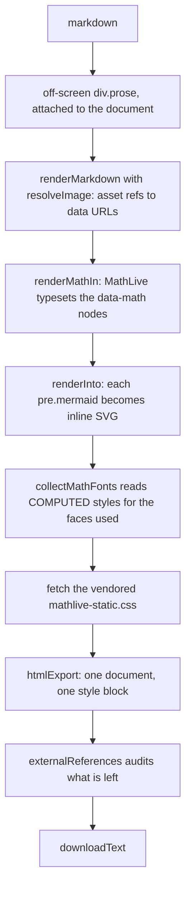
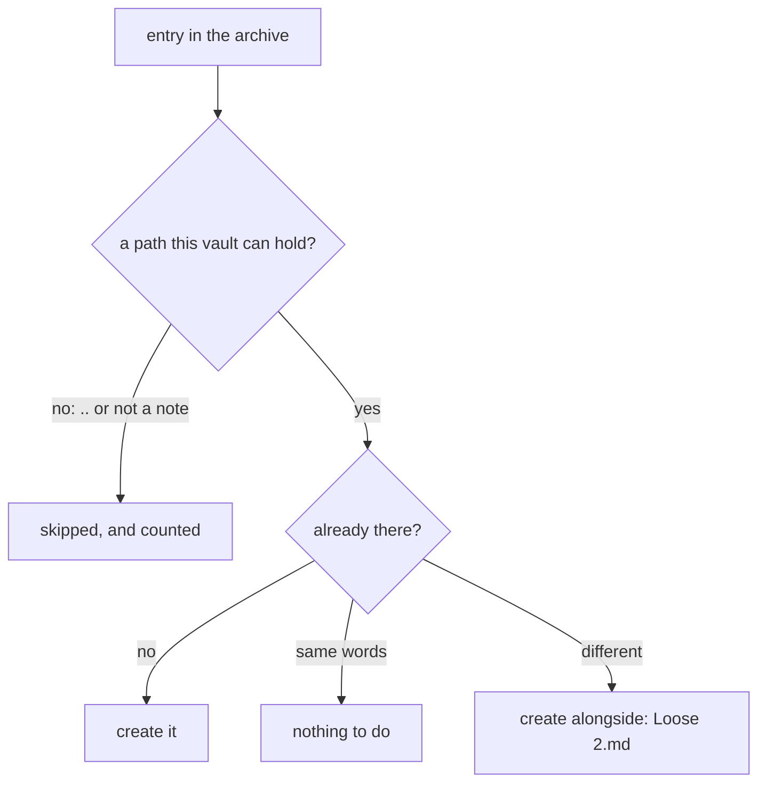
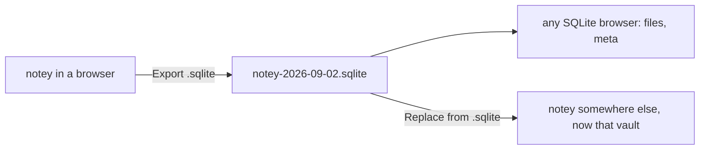

# Exporting

Three ways out for one note — Markdown, one self-contained HTML file, and the
browser's print dialog — a zip for many, and a zip of the whole vault that
also comes back in. The first four are ported from `useful`'s notebook and
are reached from the Ctrl+K palette; the vault's own is in Settings.

_Describes the code as of v0.1.0 (unreleased; schema v1) — verify against source when in doubt._

## File map

| Path | Role |
| --- | --- |
| [src/lib/notebook/export.ts](../../src/lib/notebook/export.ts) | `markdownExport`, `NOTE_CSS`, `htmlExport`, `externalReferences`, `printDocument` |
| [src/lib/notebook/mathFonts.ts](../../src/lib/notebook/mathFonts.ts) | Which faces a rendered note's maths actually uses |
| [src/lib/zip.ts](../../src/lib/zip.ts) | A dependency-free stored-only zip writer, and `zipEntries` to read one back |
| [src/lib/vault/transfer.ts](../../src/lib/vault/transfer.ts) | `exportVault`, `importVault`, `describeImport` — the whole vault, out and in |
| [src/lib/notebook/bulk.ts](../../src/lib/notebook/bulk.ts) | `exportFileName` — sanitising and clash suffixes |
| [src/lib/exportFile.ts](../../src/lib/exportFile.ts) | `downloadText`, `downloadBlob` |
| [src/components/NoteyApp.svelte](../../src/components/NoteyApp.svelte) | `renderForExport`, `downloadHtml`, `printNote`, `runBulk` |

## The HTML export

The host must be **attached to the document**: `collectMathFonts` reads
computed styles to find out which faces a formula actually used, and detached
elements have none. Only those faces are embedded, as
`data:font/woff2;base64` `@font-face` rules — a note with no maths embeds no
fonts at all.

What travels inside the file: the rendered body, `NOTE_CSS`, MathLive's
layout stylesheet when there is maths, the faces that maths used, every image as a
data URL, and every diagram as already-drawn SVG. What stays outside: only
URLs you wrote yourself, and the export tells you how many.

`htmlExport` never emits a `<script>` or a `<link>`; the whole stylesheet has
`<` escaped as `\3c ` so nothing in CSS can close the `<style>` element or
spell a tag, and the title is entity-escaped. The Playwright case asserts all
of that, plus that the only absolute URLs left are XML namespace names,
which a renderer writes into MathML and no browser resolves, and that the
MathLive markup (`ML__latex`) is there.

## The Markdown export

`markdownExport` inlines every `.assets/` ref as a data URL so the file stands
alone, and prepends `# Title` unless the body already opens with exactly that
heading. Frontmatter is not included: the export is the note, not the record.

## Print / PDF

There is no PDF writer. `printDocument(title)` swaps `document.title` (which
is what the browser offers as the filename), calls `window.print()`, and
restores the title on `afterprint` with a 60-second fallback. The page itself
renders into a `.print-only` container while everything with
`data-print="hide"` is hidden by the print stylesheet in
[global.css](../../src/styles/global.css).

## Many at once

Tick rows in a palette list view and pick `.md zip` or `.html zip`.
`exportFileName` sanitises each title to `[a-z0-9._-]`, caps the stem at 120
characters, and adds `-2`, `-3`… on a clash, compared case-insensitively
against the names already taken. The archive is **stored, not deflated**: the
files inside already carry their images as base64, so there is little to
squeeze, and every unzip — including the browser's own — reads stored entries.
The name is `notes-YYYY-MM-DD.zip`.

## The whole vault

Settings has **Export everything** and **Import a zip**
([transfer.ts](../../src/lib/vault/transfer.ts)). This is a different job
from the exports above, and the difference is worth keeping straight:

| | One note, or many | The whole vault |
| --- | --- | --- |
| What a file holds | the note as a document, images inlined, frontmatter dropped | the file exactly as the vault stores it, frontmatter and all |
| Layout | one flat archive of titles | the folders as they are — `Work/Plan.md`, `Work/.assets/shot.png`, empty notebooks too |
| Comes back in | no | yes |

So the export is what the Tauri build already keeps in its folder, zipped:
a backup, the way to carry a vault to another browser, and something you can
simply unzip and read.

Import **adds and never overwrites**, which is what makes it safe to run a
stale backup into a live vault:

Three details that follow from that:

- **Notes use `create`, not `write`**, so the vault itself refuses a path
  that is taken and the clash is handled here rather than raced.
- **An image whose name is taken is left alone.** Its name IS the reference
  a note carries (`.assets/shot.png`), so it cannot be filed under another
  one; what is already in the vault stays.
- **Importing the same archive twice is a no-op**, and every path the second
  run recognises is counted as "already here" rather than duplicated.

It runs under `notey:vault-mutate` and skips notes another tab has open, so
an import cannot interleave with another tab's rename or write over a note
being edited elsewhere (see [data-layer.md](data-layer.md)).

## The database itself

Settings also has **Export .sqlite** and **Replace from .sqlite**, which are
neither a backup nor a document: they are the browser's database file, for
looking at someone's actual rows when their notes are behaving oddly.

- **Export** is `sqlite3_js_db_export` on the live handle
  ([sqlite-worker.ts](../../src/lib/vault/sqlite-worker.ts)), which
  serialises whatever database it is given — so it is one call for all
  three storage tiers, and what comes out passes `PRAGMA integrity_check`
  in an ordinary SQLite client.
- **Import copies rows, it does not swap the file.** The incoming bytes are
  opened as a database of their own with `sqlite3_deserialize`, checked
  (does it have a `files` table? is its `user_version` one this build
  knows?), brought up to the current schema with the same `migrate` an old
  vault gets, and then its `files` and `meta` are copied into the live
  database in ONE transaction. The alternative — `poolUtil.importDb`, which
  writes the bytes straight into the OPFS handle — would mean closing and
  reopening the live database, works only on the OPFS tier, and leaves a
  wreck if the file turns out not to be a vault. This way a bad file is
  refused with a reason and nothing has changed.
- **It is destructive by design.** The zip import merges because a backup
  should never cost you a note; this one replaces, because the point is to
  see exactly what the other person sees. The confirm dialog says so.
- **Every tab reloads afterwards.** `importDb` broadcasts a `reload` change
  (see [data-layer.md](data-layer.md)); each tab flashes, suppresses its
  pagehide flush — its open note belongs to a vault that no longer exists,
  and writing it would put someone else's note into the imported vault —
  and reloads.

## Known limits and decisions

- **Downloads go through an anchor**, so under Tauri they land in the
  browser-style download path rather than a native save dialog. A native
  dialog is a 0.2.0 job.
- **The bulk HTML export renders each note in turn**, off-screen, including
  its maths and diagrams. Fifty notes with diagrams is a slow click; there is
  no progress bar, only the receipt at the end.
- **PDF page size and margins are the browser's.** notey only supplies the
  stylesheet and the filename.
- **Exports never write to the vault**, so exporting is always safe.
- **Import holds the whole archive in memory** — it is one `Uint8Array` and
  one pass. Fine for a personal vault; a vault of thousands of images would
  want streaming.
- **Import is additive only.** There is no "replace everything", because the
  destructive version of this button is one misclick from losing the lot;
  delete what you do not want afterwards, in the palette. (The `.sqlite`
  import IS that destructive version, which is why it is a separate button
  with a confirm rather than an option on this one.)
- **`.sqlite` export and import are browser-only.** The desktop vault is a
  folder of real `.md` files, so there is no database to dump; the buttons
  are not shown there, and the zip covers that case.
- **The database crosses the tab channel as one array.** A follower's
  export is structured-cloned from the owner tab. Fine at the size a
  personal vault reaches; it is not a streaming API.
