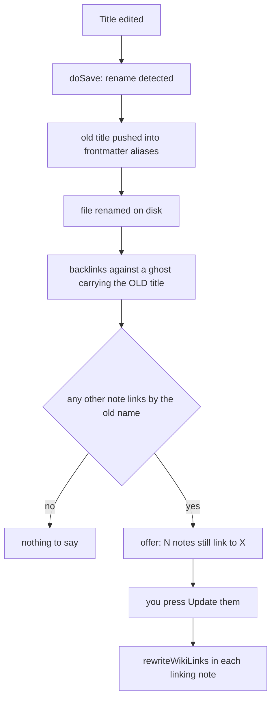

# Links and search

Notes point at each other by **title**, not by path — so moving a note or
renaming a folder never breaks a link. Backlinks are computed from the bodies
every time they are asked for. Search is a linear scan over the same
in-memory model.

_Describes the code as of v0.1.0 (unreleased; schema v1) — verify against source when in doubt._

## File map

| Path | Role |
| --- | --- |
| [src/lib/notebook/wiki.ts](../../src/lib/notebook/wiki.ts) | `findWikiLinks`, `resolveNote`, `rewriteWikiLinks`, `backlinks` |
| [src/lib/vault/search.ts](../../src/lib/vault/search.ts) | `parseQuery`, `searchNotes`, snippets |
| [src/lib/fuzzy.ts](../../src/lib/fuzzy.ts) | `fuzzyScore` — the palette's command and title matcher |
| [src/components/CommandPalette.svelte](../../src/components/CommandPalette.svelte) | The Links view and the search rows |
| [src/components/NoteyApp.svelte](../../src/components/NoteyApp.svelte) | The rename offer and `rewriteLinks()` |

## Resolving a link

`[[Title]]` and `[[Title|label]]`. `WIKI_LINK_RE` is shared with the markdown
renderer so both tokenize the same syntax, and `findWikiLinks` scans a
code-masked copy of the text (fences and inline spans blanked, offsets
preserved) so a link inside a code block is not a link.

Resolution is by `normalizeTitle` — NFC, collapsed whitespace, lowercased —
and **a title match beats an alias match**. A link that resolves to nothing is
rendered with a dashed underline in the stamp colour, and following it creates
that note, under that name, beside the note that linked to it.

## Rename, alias, offer

Nothing is rewritten unless you press the button. Until you do — and after,
if you never do — the old links keep working, because the old title is an
alias. The "ghost" in the diagram is a copy of the note carrying its old
title and no aliases; counting backlinks against it is what produces the
number in the offer.

Renaming a **folder** rewrites nothing at all: links do not carry paths.

## Backlinks

`backlinks(notes, target)` counts, for every other note, how many of its
`[[links]]` resolve to the target's title or any of its aliases, and sorts by
title. It is computed on demand in the palette's Links view. Nothing is
stored, so nothing can be stale — including after restoring an old vault.

## Search

`parseQuery` splits the input into words, `tag:` filters and one `book:`
filter (`book:pile` means the root). Every word must match somewhere; every
tag must be present; the notebook must match.

| Where the word matched | Score |
| --- | --- |
| Title, at the start | 24 |
| Title, elsewhere | 16 |
| An alias | 10 |
| A tag | 10 |
| The path | 6 |
| The body | 3, and the hit carries a snippet |

Ties break on title order, so results are stable. A filter-only query
(`tag:baking` with no words) matches with a flat score.

The palette's root shows commands scored by `fuzzyScore` first, then up to
eight search hits — so typing "brea" offers both "Blank page" (a fuzzy
command match) and every note about bread.

## Known limits and decisions

- **A linear scan, not FTS5.** Every body is already in memory for links and
  backlinks; scanning them is unmeasurable at personal-vault scale, and an
  index would be a second source of truth to keep honest. The reasoning and
  what would flip it are in [far-fetched.md](plans/far-fetched.md).
- **Search is substring, not stemmed.** "bake" does not find "baking". Tags
  are what you use when you want recall.
- **Two notes may share a title.** They are different files in different
  folders; `resolveNote` takes the first match in vault order. Aliases have
  the same exposure. A title is a name, not a key.
- **The snippet is the first body hit only**, with whitespace collapsed.
