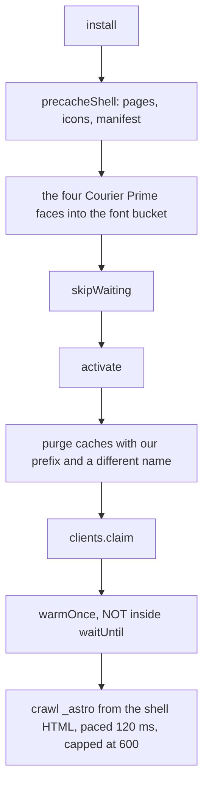
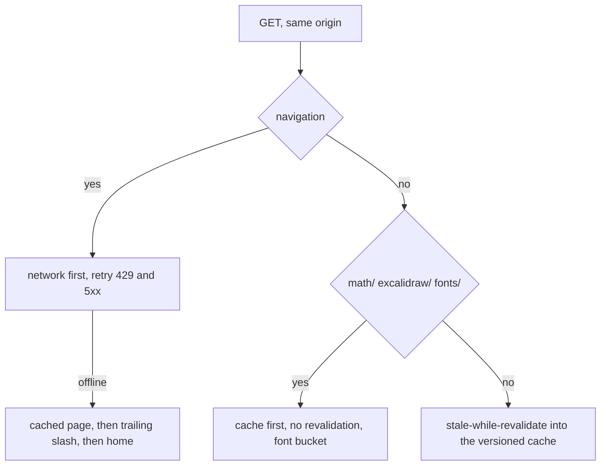

# The service worker

notey is offline-first: after the first visit everything works with the
network unplugged, including pages you have never opened. The worker is
ported from `useful`'s, which encodes a fixed bug in nearly every line — the
comments there are load-bearing and were kept.

_Describes the code as of v0.1.0 (unreleased; schema v1) — verify against source when in doubt._

## File map

| Path | Role |
| --- | --- |
| [public/sw.js](../../public/sw.js) | The worker |
| [public/manifest.webmanifest](../../public/manifest.webmanifest) | Install metadata |
| [src/layouts/Layout.astro](../../src/layouts/Layout.astro) | Registration in production, unregistration in dev |
| [src/lib/persistence.ts](../../src/lib/persistence.ts) | `navigator.storage.persist()` and the usage estimate |

## Caches

| Name | Holds | Purged on a version bump |
| --- | --- | --- |
| `notey-cache-v1` | The shell, the pages, every `_astro/` chunk | yes |
| `notey-fonts-v1` | `math/`, `excalidraw/`, `fonts/` | **no** |

`CACHE_PREFIX = 'notey-cache-'` scopes the purge, because Cache Storage is
keyed by **origin**, not by worker scope: a co-hosted app on the same origin
must not have its caches evicted. The font bucket sits deliberately outside
that prefix — re-downloading unchanged KaTeX, Excalidraw and Courier Prime
faces because a stylesheet changed would be indefensible.

`BASE` is derived from `self.registration.scope`, so the same file works at
the domain root and under `/notey/` on GitHub Pages.

## Install, activate, crawl

The crawl is **not** inside `activate`'s `waitUntil`: a worker is
"activating" until that promise settles, and the browser holds navigations
and `new Worker()` calls until it activates — with the crawl in there, every
click on a fresh install hangs for as long as the crawl runs. The fetch
handler's own `waitUntil(warmOnce())` keeps the worker alive to resume
instead, which matters because browsers kill idle workers and a paced crawl
spends most of its time asleep.

Astro emits no precache manifest, so the crawl **is** the manifest: it reads
cached HTML/JS/CSS and follows `_astro/...` references and relative
specifiers — including the backtick form the bundler emits for dynamic
imports. `ASSET_FILE` rejects anything with a slash or no extension, because
minified code is full of strings that look like paths and are not; `.wasm`
and `.data` are skipped so sqlite's engine is fetched on first use rather
than on every install.

## Fetch routing

Two details that look like noise and are not:

- **`ignoreVary: true` on every match.** Servers send `Vary: Origin`, and a
  module `import()` carries an `Origin` header while an install-time fetch
  does not — without it, cached lazy chunks are refused to module loads and
  the editor breaks offline.
- **`ignoreSearch: true` for navigations**, with the bare pathname as the
  key, so `/?note=a` and `/?note=b` share one cached page.

Every path resolves with a real `Response` — resolving `respondWith` with
anything else makes Chromium report a confusing synthetic 503.

## Development

The worker must not run in dev: it would cache Vite's module URLs and serve
stale code after every edit. `Layout.astro` registers it only under
`import.meta.env.PROD`, and in dev actively unregisters any leftover worker
and deletes only caches starting `notey-cache-`.

Under **Tauri** it is skipped entirely (`__TAURI_INTERNALS__` present): the
desktop app serves from its own protocol and has no network to be offline
from.

## Storage durability

Being cached is not the same as being kept. `requestPersistentStorage()`
asks the browser to exempt the origin from eviction; Settings shows the
answer and the usage estimate. This matters most on iOS, which evicts all
site storage after about a week of not opening the app.

## Known limits and decisions

- **`CACHE_NAME` is bumped by hand.** The activate purge only deletes caches
  whose name differs, so forgetting the bump makes that step dead code.
- **No "download everything" button yet.** useful has one that messages the
  worker for an unpaced crawl; notey ships the protocol (`notey-warm`) but no
  UI for it.
- **The crawl is capped at 600 assets.** Comfortably above what this app
  emits, and a hard stop against a runaway.
- **New pages must join `SHELL`.** A page that is not in it is only cached
  after you visit it.
