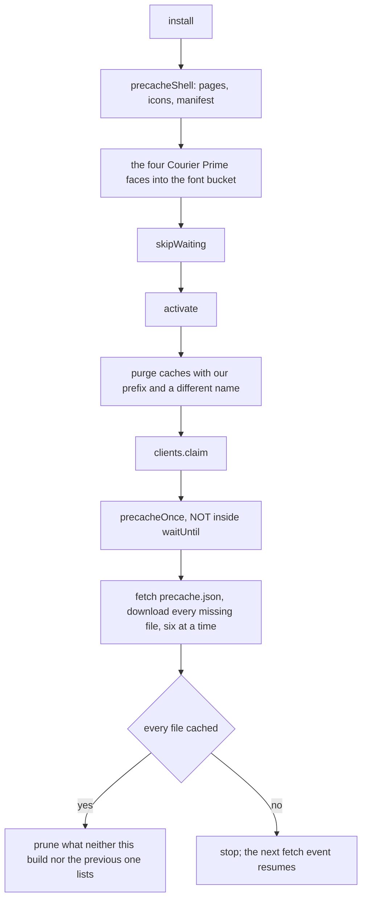

# The service worker

notey is offline-first: one visit downloads the whole build, and after that
everything works with the network unplugged — including pages, features and
fonts you have never opened. The worker is ported from `useful`'s, which
encodes a fixed bug in nearly every line; the comments there are
load-bearing and were kept.

_Describes the code as of v0.1.0 (unreleased; schema v1) — verify against source when in doubt._

## File map

| Path | Role |
| --- | --- |
| [public/sw.js](../../public/sw.js) | The worker |
| [tools/astro-precache.mjs](../../tools/astro-precache.mjs) | Build hook: writes `dist/precache.json` |
| [tools/precache-manifest.mjs](../../tools/precache-manifest.mjs) | Which emitted files go in it, and under what path |
| [src/lib/offline.ts](../../src/lib/offline.ts) | The page's side of the offline-copy protocol (Settings) |
| [public/manifest.webmanifest](../../public/manifest.webmanifest) | Install metadata |
| [src/layouts/Layout.astro](../../src/layouts/Layout.astro) | Registration in production, unregistration in dev |
| [src/lib/persistence.ts](../../src/lib/persistence.ts) | `navigator.storage.persist()` and the usage estimate |

## The manifest

Astro emits no precache manifest, so the build writes one.
`astro:build:done` walks `dist/` and writes `precache.json`: every file, as
a path relative to the base, so the same list works at the domain root and
under `/notey/`. The rules live in `manifestPaths` and are unit-tested:

- `index.html` is listed as `''` and `x/index.html` as `x/` — the key the
  worker stores navigations under, so the precached page and a later visit
  to it are one entry, not two.
- `sw.js` and `precache.json` are left out. A cached copy of either can
  only hide a new deployment.
- Source maps and dot-files are left out.

The worker used to **crawl** instead: cache the shell, regex `_astro/…`
references out of the HTML and JS, follow them, repeat — paced at 120 ms a
file and capped at 600. A regex over minified code is a guess, and a chunk
it guessed wrong about was simply missing the first time someone opened that
feature offline, with no way to tell from outside. The crawl also skipped
`.wasm`, so the sqlite engine was only cached if it had been used online.

## Caches

| Name | Holds | Purged on a version bump |
| --- | --- | --- |
| `notey-cache-v3` | The pages, every `_astro/` chunk, the sqlite engine, `precache.json`, the worker's generation note | yes |
| `notey-fonts-v1` | `math/`, `excalidraw/`, `fonts/` | **no** |

`CACHE_PREFIX = 'notey-cache-'` scopes the purge, because Cache Storage is
keyed by **origin**, not by worker scope: a co-hosted app on the same origin
must not have its caches evicted. The font bucket sits deliberately outside
that prefix — re-downloading unchanged MathLive, Excalidraw and Courier
Prime faces because a stylesheet changed would be indefensible.

A version bump is no longer how stale files leave. After a run that cached
every listed file, `prune` deletes whatever neither **this build nor the one
before it** lists, without anybody having to remember to bump anything.
Pruning only ever follows a COMPLETE run: a half-finished one says nothing
about what the build contains.

One previous build is kept, not zero, because of other tabs. When the new
worker claims a tab opened before the update, that tab is still running the
old build's code, and the lazy chunks it has not loaded yet exist nowhere
else — the host has replaced them. Dropping them at once broke that tab's
first diagram or drawing until a reload. The worker notes which build it
last finished, and which build came before, under a cache-only key
(`__notey-precache-state`); a finished run of a NEW build demotes the noted
one to "previous", and the build before that is what goes.

`BASE` is derived from `self.registration.scope`, so the same file works at
the domain root and under `/notey/` on GitHub Pages.

## Install, activate, download

**Install caches the shell only.** A worker is not "installed" until that
promise settles, and an install the browser kills part way through starts
over. The whole build downloads in `activate`'s background instead.

**The download is not inside `activate`'s `waitUntil`.** A worker is
"activating" until that promise settles, and the browser holds navigations
and `new Worker()` calls until it activates — with the download in there,
every click on a fresh install would wait for the whole build.

**It is not paced and not capped.** Six fetches in flight at once, no delay
between them, no ceiling on how many. The first visit pays for every later
one; that is the point.

**It resumes.** Browsers kill idle workers, so a long download is regularly
cut short. The fetch handler's own `waitUntil(precacheOnce())` restarts it,
and it skips everything already cached, so each restart picks up where the
last one stopped.

`precache.json` is always fetched with `cache: 'reload'` — past the HTTP
cache — or a new deployment could stay invisible for as long as the old list
is fresh. The copy the worker keeps in its own cache is only for answering a
status question offline.

## The offline copy in Settings

Settings shows whether the download finished, and offers to finish it now
when it has not. Only the worker can answer — the page cannot see the
manifest or count the caches — so this is a message protocol:

| Page sends | Worker replies |
| --- | --- |
| `{ type: 'notey-offline', action: 'status' }` | `{ type: 'notey-offline-status', ready, missing, total }` |
| `{ type: 'notey-offline', action: 'download' }` | `notey-offline-progress` per file, then `{ type: 'notey-offline-done', complete }` |

[offline.ts](../../src/lib/offline.ts) wraps both, and returns `null` when
no worker controls the page (dev, the desktop build, a browser with workers
off) so the panel shows nothing rather than an error.

**Asking is also a nudge.** A run that ended short — the host ran out of
sockets, the browser stopped the worker, an entry was evicted since — is
otherwise resumed only by the next fetch, and a page sitting on Settings
makes none. So a status answer that counts anything missing also clears
`precacheDone` and runs the download again. The panel asks every two seconds
while the copy is incomplete, so the line keeps itself current and an open
panel is what finishes a stalled run. It used to ask once, on open, and said
"25 of 376 files still to download" for as long as it stayed open — the
Playwright suite caught it under load.

## Fetch routing

Two details that look like noise and are not:

- **`ignoreVary: true` on every match.** Servers send `Vary: Origin`, and a
  module `import()` carries an `Origin` header while a worker-side fetch
  does not — without it, cached lazy chunks are refused to module loads and
  the editor breaks offline.
- **`ignoreSearch: true` for navigations**, with the bare pathname as the
  key, so `/?note=a` and `/?note=b` share one cached page.

Every path resolves with a real `Response` — resolving `respondWith` with
anything else makes Chromium report a confusing synthetic 503.

## Development

The worker must not run in dev: it would cache Vite's module URLs and serve
stale code after every edit. `Layout.astro` registers it only under
`import.meta.env.PROD`, and in dev actively unregisters any leftover worker
and deletes only caches starting `notey-cache-`.

Under **Tauri** it is skipped entirely (`__TAURI_INTERNALS__` present): the
desktop app serves from its own protocol and has no network to be offline
from.

## Storage durability

Being cached is not the same as being kept. `requestPersistentStorage()`
asks the browser to exempt the origin from eviction; Settings shows the
answer and the usage estimate. This matters most on iOS, which evicts all
site storage after about a week of not opening the app.

## Known limits and decisions

- **The first visit downloads everything**, about 15 MB, most of it
  mermaid's per-diagram chunks. That is the trade asked for: the first
  connection is the only one that has to be good.
- **KaTeX is in that download and never runs.** Crepe imports it statically
  for a LaTeX feature notey switches off (see [editor.md](editor.md)), so
  the bundler cannot drop it; about 260 KB.
- **New pages need nothing.** Anything the build emits is in the manifest.
  Files fetched from somewhere else at run time would not be — there are
  none, and there must not be.
- **A host that refuses a file** leaves the run incomplete: nothing is
  pruned, Settings says how many files are missing, and the next run tries
  again.
