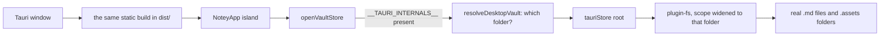
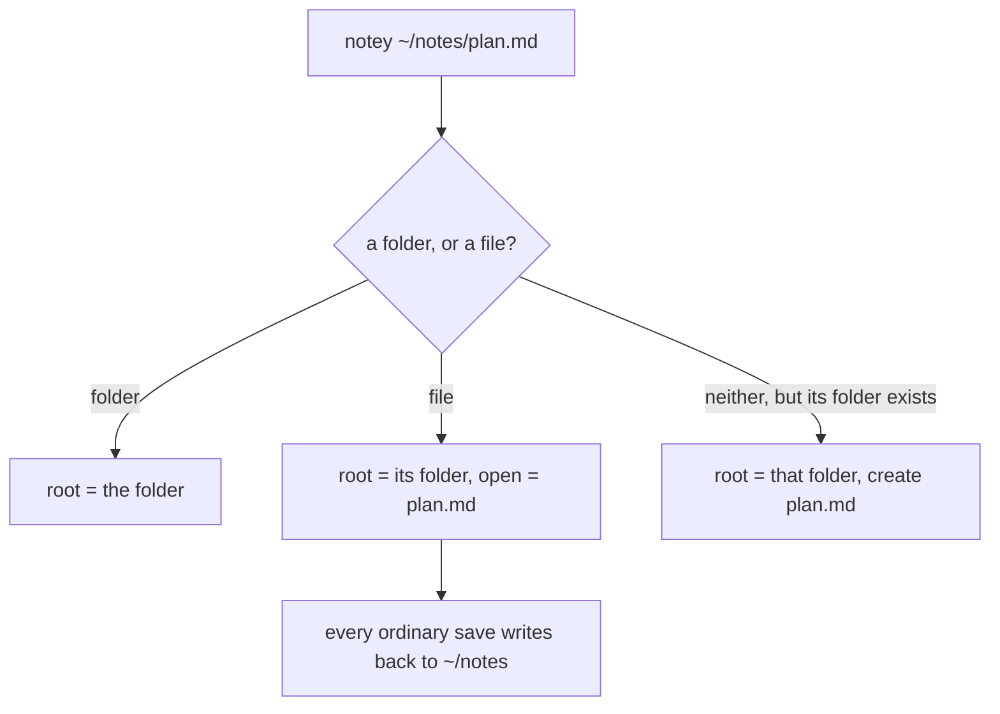

# The desktop build

The same frontend, with the vault pointed at a real folder you choose. Notes
are plain `.md` files any other editor can open, and — because the folder is
a parameter rather than a constant — notey can be pointed at one file and
edit it where it lies.

_Describes the code as of v0.1.0 (unreleased; schema v1) — verify against source when in doubt._

## File map

| Path | Role |
| --- | --- |
| [src-tauri/tauri.conf.json](../../src-tauri/tauri.conf.json) | Window, bundle, and the dev/build commands |
| [src-tauri/capabilities/default.json](../../src-tauri/capabilities/default.json) | The fs permissions and their scope |
| [src-tauri/src/lib.rs](../../src-tauri/src/lib.rs) | The whole Rust side: two plugins, two commands |
| [src/lib/vault/tauriStore.ts](../../src/lib/vault/tauriStore.ts) | The filesystem `VaultStore`, over a root it is given |
| [src/lib/vault/desktop.ts](../../src/lib/vault/desktop.ts) | Which folder, and which file: the launch argument, the pickers |
| [src/lib/vault/desktopPaths.ts](../../src/lib/vault/desktopPaths.ts) | The path arithmetic behind it, tested without a desktop |
| [src/components/DesktopWelcome.svelte](../../src/components/DesktopWelcome.svelte) | The first-run "here is where your notes go" |
| [src/lib/vault/store.ts](../../src/lib/vault/store.ts) | Picks it when Tauri is present; `remountVault` moves it |

## How it fits together



Detection is `'__TAURI_INTERNALS__' in window`. The service worker
registration in `Layout.astro` checks the same thing and skips: the app is
served from Tauri's own protocol, and a worker there would only cache a
moving target.

## Which folder

Three answers, in this order ([desktop.ts](../../src/lib/vault/desktop.ts)):

1. **What notey was launched with.** `notey ~/notes/plan.md`, or the path the
   shell hands over when a `.md` is opened with notey. Read in Rust by
   `opened_with`, which is just `std::env::args().nth(1)` — a browser has no
   argv, so this cannot live in the frontend.
2. **The folder you chose**, kept in `prefs.vaultRoot`.
3. **`Documents/Notey`**, made on first run.

### Pointing at a file is pointing at its folder

`notey plan.md` mounts the folder `plan.md` sits in and opens that file:



This is the whole trick behind "acts like an editor". There is no second
code path for external files: once the file's folder IS the vault, saving,
renaming, `[[links]]`, images and search all work as they always do, and
they work **in that folder**. `launchTarget` in
[desktopPaths.ts](../../src/lib/vault/desktopPaths.ts) is the rule, and it
is unit-tested for Windows and POSIX paths alike.

A launch argument is deliberately **not remembered**: opening one file
should not move the vault you chose. Only the picker and the welcome write
`prefs.vaultRoot`. `Ctrl+K → Edit existing file` does the same as a launch
argument, mid-session, through `remountVault`; it is added to the palette
only when `isTauri()`, because a browser cannot write back to where a file
came from.

## What the store does with a real directory

`loadAll` walks the tree and classifies:

- a directory becomes a folder,
- a `.md` file **outside** any `.assets/` becomes a note (content read),
- anything inside `.assets/` becomes an asset (metadata only — bytes are read
  by `list()` when a note is opened),
- **everything else is invisible.** A stray `.txt`, a `.git` folder, a
  `.notey.json`: notey does not list them, does not touch them, and does not
  delete them. They do ride along when a folder is renamed and they do go
  down with a folder delete, because those act on the real directory — which
  is the honest behaviour for a real filesystem.

Vault-level metadata lives in `.notey.json` at the vault root, so the folder
stays self-describing on disk.

## Permissions

The capability grants exactly the fs verbs the store calls, scoped to the
default vault:

```json
{ "identifier": "fs:scope",
  "allow": [{ "path": "$DOCUMENT/Notey" }, { "path": "$DOCUMENT/Notey/**" }] }
```

A capability is baked in at build time, so it can only name paths that were
known then — which is exactly what a folder picker is not. The `allow_folder`
command widens the scope at run time:

```rust
app.fs_scope().allow_directory(&path, true)
```

It reads and writes nothing itself; it only permits, and only a folder the
person named through the picker or on the command line. Everything else on
the disk stays unreachable from the frontend.

## Building it

```bash
npm run tauri:dev     # astro dev + the window, hot reload
npm run tauri:build   # astro build, then an installer in src-tauri/target
```

The Rust toolchain is required (`cargo` and `rustc`); the JS side needs
nothing extra. `beforeBuildCommand` runs `npm run build`, so the bundled app
always carries a fresh `dist/`.

## Known limits and decisions

- **No file watching.** Edit a note in another editor while notey has it open
  and notey will not notice; its next save writes over the change. Reopen the
  app to pick up outside edits. This matters more now that notey can be
  pointed at a folder something else is working in.
- **Moving the vault does not move the notes.** Choosing a new folder points
  notey at it; what was written in the old one stays there. Use the zip
  export and import to carry notes across.
- **A launch argument only lasts the session.** That is deliberate (see
  above), but it does mean `notey somewhere/else.md` shows a vault that is
  not the one Settings names, until the next launch.
- **Downloads still go through an anchor**, so exports land in the browser
  download path rather than a native save dialog.
- **The desktop build has no Playwright coverage.** The suite drives the
  browser build; `memoryStore.test.ts` pins the store contract that
  `tauriStore` implements, and `desktopPaths.test.ts` pins the folder rules.
  The wiring between them — the pickers, the welcome, `opened_with` — is
  checked by `cargo check` and the type checker, and has NOT been run in a
  real window. Run `npm run tauri:dev` and try: a first launch, `notey .`,
  `notey some/file.md`, and `Ctrl+K → Edit existing file`.
