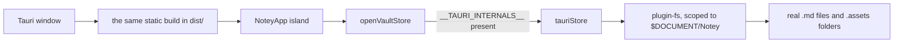

# The desktop build

The same frontend, with the vault pointed at a real folder. Notes are plain
`.md` files in `Documents/Notey` that any other editor can open, and the only
code that knows the desktop exists is one `VaultStore` implementation.

_Describes the code as of v0.1.0 (unreleased; schema v1) — verify against source when in doubt._

## File map

| Path | Role |
| --- | --- |
| [src-tauri/tauri.conf.json](../../src-tauri/tauri.conf.json) | Window, bundle, and the dev/build commands |
| [src-tauri/capabilities/default.json](../../src-tauri/capabilities/default.json) | The fs permissions and their scope |
| [src-tauri/src/lib.rs](../../src-tauri/src/lib.rs) | The whole Rust side: two plugins and a builder |
| [src/lib/vault/tauriStore.ts](../../src/lib/vault/tauriStore.ts) | The filesystem `VaultStore` |
| [src/lib/vault/store.ts](../../src/lib/vault/store.ts) | Picks it when Tauri is present |

## How it fits together



Detection is `'__TAURI_INTERNALS__' in window`. The service worker
registration in `Layout.astro` checks the same thing and skips: the app is
served from Tauri's own protocol, and a worker there would only cache a
moving target.

## What the store does with a real directory

`loadAll` walks the tree and classifies:

- a directory becomes a folder,
- a `.md` file **outside** any `.assets/` becomes a note (content read),
- anything inside `.assets/` becomes an asset (metadata only — bytes are read
  by `list()` when a note is opened),
- **everything else is invisible.** A stray `.txt`, a `.git` folder, a
  `.notey.json`: notey does not list them, does not touch them, and does not
  delete them. They do ride along when a folder is renamed and they do go
  down with a folder delete, because those act on the real directory — which
  is the honest behaviour for a real filesystem.

Vault-level metadata lives in `.notey.json` at the vault root, so the folder
stays self-describing on disk.

## Permissions

The capability grants exactly the fs verbs the store calls, scoped to two
paths:

```json
{ "identifier": "fs:scope",
  "allow": [{ "path": "$DOCUMENT/Notey" }, { "path": "$DOCUMENT/Notey/**" }] }
```

Nothing else on the disk is reachable from the frontend. `plugin-dialog` is
included for the save dialogs a later version will want.

## Building it

```bash
npm run tauri:dev     # astro dev + the window, hot reload
npm run tauri:build   # astro build, then an installer in src-tauri/target
```

The Rust toolchain is required (`cargo` and `rustc`); the JS side needs
nothing extra. `beforeBuildCommand` runs `npm run build`, so the bundled app
always carries a fresh `dist/`.

## Known limits and decisions

- **The vault path is fixed at `Documents/Notey`.** A picker means a dynamic
  fs scope and a stored path; it is a 0.2.0 feature. The fixed path ships
  sooner and keeps the capability narrow.
- **No file watching.** Edit a note in another editor while notey has it open
  and notey will not notice; its next save writes over the change. Reopen the
  app to pick up outside edits.
- **Downloads still go through an anchor**, so exports land in the browser
  download path rather than a native save dialog.
- **The desktop build has no Playwright coverage.** The suite drives the
  browser build; `memoryStore.test.ts` is what pins the store contract that
  `tauriStore` implements.
