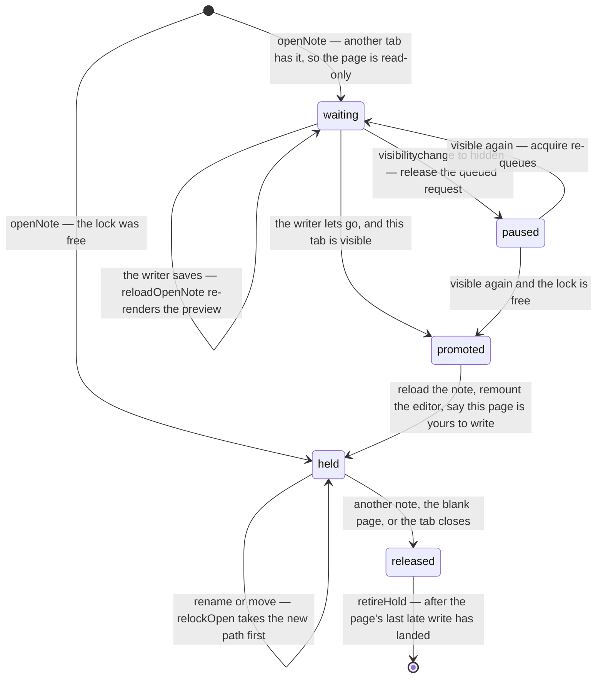

# The page and the palette

notey has no sidebar, no menu bar and no toolbar of its own. It opens on a
blank, unfiled sheet in an 8 × 11 shape, and every command and every
navigation runs through Ctrl+K. The only chrome on the page is a closed book
in the corner, which opens the same palette on the library.

_Describes the code as of v0.1.0 (unreleased; schema v1) — verify against source when in doubt._

## File map

| Path | Role |
| --- | --- |
| [src/components/NoteyApp.svelte](../../src/components/NoteyApp.svelte) | The page: title, frontmatter, red rule, editor host, and every action the palette calls |
| [src/components/CommandPalette.svelte](../../src/components/CommandPalette.svelte) | The palette: view stack, commands, library views, bulk bar |
| [src/components/SettingsPanel.svelte](../../src/components/SettingsPanel.svelte) | Settings, as a palette view |
| [src/lib/prefs.ts](../../src/lib/prefs.ts) | Startup mode, editor face, the look, and the unfiled scratch (`ScratchScope`: shared or this tab's own) |
| [src/lib/vault/noteLocks.ts](../../src/lib/vault/noteLocks.ts) | The lock a page holds on its note, the blank page's lock, the mutate lock |
| [src/lib/vault/tabs.ts](../../src/lib/vault/tabs.ts) | How every tab reaches the one database; the `changed` feed the page follows |
| [src/layouts/Layout.astro](../../src/layouts/Layout.astro) | The pre-paint look script; no chrome of its own |

## The page

```
┌───────────────────────────────────────────────┐ ← .sheet, 8 × 11
│ THE PILE                     CREATED  2026-09 │
│ Bread notes                  UPDATED  2026-09 │ ← title left,
│ Also answers to: Loaf notes  INSIDE   Recipes │   frontmatter right
│                              TAGS     baking  │
│                              + FIELD          │
├═══════════════════════════════════════════════┤ ← the red rule
│ ◇ Diagram  ✏ Draw  ⁋ Footnotes  Edit Src Prev │
│                                               │
│ Sourdough starts with a good starter…         │
└───────────────────────────────────────────────┘
```

The sheet is `--page-width: 120ch` wide with
`min-height: min(calc(var(--page-width) * 11 / 8), calc(100vw * 11 / 8))` —
an 8 × 11 page that is that tall when empty and grows **past** it when the
writing runs long. Deliberately a minimum and not `aspect-ratio`: that gives
the box a definite height, and the writing overflows it onto the desk.
Under 56rem of viewport the sheet goes fluid and the frontmatter block moves
below the title.

**The unfiled page shows no frontmatter at all**: there is nothing true to
say about a note that does not exist yet. It is one title input with an
`Untitled` placeholder, the red rule, and the editor telling you to press
Ctrl+K or just start typing.

## The book

A closed book, fixed in the corner. Clicking it opens the palette and the
glyph becomes an open book; clicking it again closes it. Its `z-index` is 90
— above the palette's backdrop at 80 — because a button that opens something
must be able to close it again.

## The palette

```mermaid
stateDiagram-v2
  [*] --> root: Ctrl+K or the book
  root --> notebooks: View notebooks
  notebooks --> notebook: pick one
  notebook --> notebooks: Escape
  root --> pile: View the Pile
  root --> links: Links to and from this note
  root --> settings: Settings
  settings --> root: Escape
  root --> newNotebook: New notebook…
  notebook --> newNotebook: New folder inside
  pile --> tag: Tag (with rows ticked)
  pile --> move: Move (with rows ticked)
  tag --> pile: applied
  move --> pile: applied
  notebooks --> root: Escape
  root --> [*]: Escape, or an action that lands you on a page
```

Two rules give the palette its character:

1. **Browsing keeps you in the palette.** "View notebooks" shows the
   notebooks and stays open, because looking around takes several steps.
   Only an action that puts you on a page — open a note, create one, print —
   closes it. Settings are a view of their own and stay.
2. **Escape walks back one level**, and closes only from the root. So does
   Backspace on an empty query.

### What the root offers

Always: New note · New notebook… · View notebooks · View the Pile · Blank
page · Settings. Plus the notes themselves — the five most recently updated
when the query is empty, or the search results when it is not.

The two lists are labelled: a **Commands** heading and a **Recent notes** /
**Notes** heading. A note and a command look alike at a glance, and the
difference decides what Enter does. Headings are rows in the same list with
`kind: 'header'`; arrow keys step over them because navigation indexes
`targets`, which is the list without them.

With an unfiled page that has something on it: **File this note in the
Pile**, and one command per notebook.

With a note open: Links to and from this note · Export as Markdown · Export
as HTML · Print / Save as PDF · Close this note · Delete this note. When the
open note is being written in another tab, "Delete this note" is replaced by
a **Being written in another tab** row that only closes the palette, and any note another tab
has open carries the hint `· open in another tab` in the list (`heldPaths`,
refreshed each time the palette opens).

### Selecting several

Rows in the Pile and notebook views carry a tick box (or Ctrl+Space on the
highlighted row). Ticking any shows the bulk bar: `.md zip`, `.html zip`,
Tag, Move, Delete, Clear. Tag and Move are their own small views — type the
tags and press Enter to add or Shift+Enter to remove; pick a destination from
a list that excludes the selection and anything inside it. Both return to the
list they came from **through `go()`**, which clears the query, or the tag
text would linger as a filter and hide every row.

The receipt line ("Moved 2 notes.") stays under the list after the action.

## One writer per page

Every tab can read and write the vault (how is in
[data-layer.md](data-layer.md)); what the page enforces is that **one tab
writes a given note at a time**. The tab with a note open holds the
exclusive Web Lock `notey:note:<path>` for as long as it is open. A second
tab opening the same note gets it **read-only** and queues for the lock.



What the read-only page looks like: the title and every frontmatter field
are disabled, the body is rendered by `MarkdownPreview`
(`notebook-read-only`) rather than mounted in the editor, the stamp slot
reads **Open in another tab** (`notey-stamp-read-only`), and a quiet line
under the red rule (`notey-read-only`) says the note is being written in
another tab and becomes writable here when that tab moves on. It follows
the writer's saves live: a `write` for the open path on the change feed
re-reads the row and bumps `previewNonce`.

The rules around that diagram:

- **Only a visible tab is promoted.** A hidden tab releases its queued
  request on `visibilitychange` and re-requests when it is visible again,
  so a forgotten background tab never takes a note from the one you are
  looking at.
- **A rename or move takes the new path's lock before the file moves**
  (`relockOpen`), so there is never a moment when the note is somewhere
  nobody holds. A save that would land on a name another tab has open
  fails with "… is open in another tab" and does not retry.
- **The lock of the page being left is released only after its last late
  write has landed** (`retireHold`, via `lateWrites`) — the editor's own
  debounce can flush a change for the previous note after the switch.
- **Saves are serialized** (`saveChain`); a failed one retries after 5 s.
  A rename whose answer was lost between tabs is recognised as already
  done (`read(to)` present, `read(from)` gone) rather than failed.
- **The blank page is locked too** (`notey:scratch`). It is one shared
  sheet in `localStorage`, so the tab that cannot have it writes on a sheet
  of its own in `sessionStorage` (`ScratchScope` `'tab'`) and never touches
  the shared one. Nobody queues for a blank page, and a tab's own sheet is
  sticky: while it has anything on it, that tab keeps using it even once
  the shared page is free, until the sheet is filed or emptied — so the
  words on it are never hidden behind another tab's.
- **Startup never lands you read-only.** With "reopen the last note" set, a
  last note that another tab has open is not reopened; the tab stays blank
  and the palette hint says where it is. A `?note=` deep link is an explicit
  ask, so it opens the note — read-only if it must.
- **New notes go through `create`**, which refuses a path that exists; the
  name is picked again from a fresh read on a clash.
- **Bulk tag, move and delete, and rewrite-links, take each touched note's
  lock for the duration** (`withNoteLock`) and leave alone any note open in
  another tab; the receipt says "N left alone: open in another tab".
  Deleting or renaming a folder takes every note inside first
  (`holdAllUnder`) and refuses outright if one is open elsewhere. A
  multi-step tree change runs under `notey:vault-mutate` so two tabs'
  loops cannot interleave.
- **Deleting the note you are only reading is refused** ("it cannot be
  deleted from here").
- **If another tab deletes the note you are writing**, the page says so
  (`notey-detached`) and your next save files it again at the same path. If
  another tab moves it, the page follows the new path (`relockOpen`) and
  says "Moved in another tab: now …".

## Where the state lives

| State | Owner | Notes |
| --- | --- | --- |
| The vault (notes, folders) | `NoteyApp` | Re-read after every write |
| The open document | `NoteyApp` | `currentPath` / `scratchOpen`, plus `mountPath` for the mounted editor |
| Palette view, query, selection | `CommandPalette` | Discarded when it closes |
| Startup, face, paper, desk, pen, last note | `localStorage` via `prefs.ts` | Per device, never in the vault |
| The unfiled page's text | `localStorage` (`notey-scratch`) | Survives reloads, writes nothing to the vault; `sessionStorage` under the same key when this tab could not get the blank page's lock |
| The page's lock | `NoteyApp` (`hold`, `lockedElsewhere`) | Held, waiting, or released; `heldPaths` is what other tabs hold |
| What other tabs changed | `NoteyApp` via `onVaultChange` | Debounced into a full refresh, 250 ms |

`prefs` and the scratch are read **at script init**, not in `onMount`:
`MarkdownEditor` is created during the first render and takes `mode` and
`value` as initial values only, so reading them later mounts the editor in
the wrong face with an empty document.

## Known limits and decisions

- **The editor is keyed on the open document, not the note path.** A rename
  changes the path, and keying on it rebuilt the editor mid-typing, throwing
  away the undo history and the caret. `mountPath` follows the rename along.
- **Delete still uses `confirm()`.** It is the one blocking, irreversible
  action, and a native dialog cannot be missed. Everything else is a receipt
  line.
- **`prompt()` was removed entirely.** Naming a notebook is an input in the
  palette, where the name will actually land.
- **The palette closes on an action that navigates.** There is no "keep it
  open" setting; if you want to do several things, the browsing views are
  where you stay.
- **No mobile affordance for Ctrl+K yet.** The book is reachable by touch,
  and it opens the same palette; the keyboard shortcut is the desktop path.
- **Settings are a palette view, not a page.** Changing how the app looks
  should not take you away from what you were writing, and there is no
  second implementation to drift. The `/settings/` route is gone.
- **The key handler is on the palette panel, not its input.** The settings
  view has no input, and Escape has to work there too; the panel takes
  focus when there is no field.
- **A click on blank paper puts the caret at the end of the writing.** A
  real page has no "outside the text", and a page that swallows a click
  reads as broken. Clicks on controls, links and the editor's own toolbar
  are still theirs.
- **Breadcrumbs open the palette on that notebook**, which is why the
  palette takes a `startAt`.
- **The book sits on a chip of paper.** It lives out on the desk, and some
  desks are close enough to the ink to wash a bare glyph out.
- **The sheet's 8 x 11 shape is a minimum, not an aspect ratio.**
  `aspect-ratio` gives the box a definite height, which long writing then
  overflows — it spilled onto the desk until this changed.
- **A read-only page is a preview, not a disabled editor.** The body is
  rendered by `MarkdownPreview`, which has no way to write. Promotion
  remounts the editor (`editorKey++`) on the freshly re-read note.
- **The visibility rule is a policy, not a lock feature.** Web Locks queue
  strictly in order; the page opts out of the queue while hidden and back
  in when shown, which is why a tab can be promoted the moment you switch
  to it.
- **The hidden-tab release is per open note only.** The blank page never
  queues, and a hold on a note this tab already writes is never let go for
  visibility.
